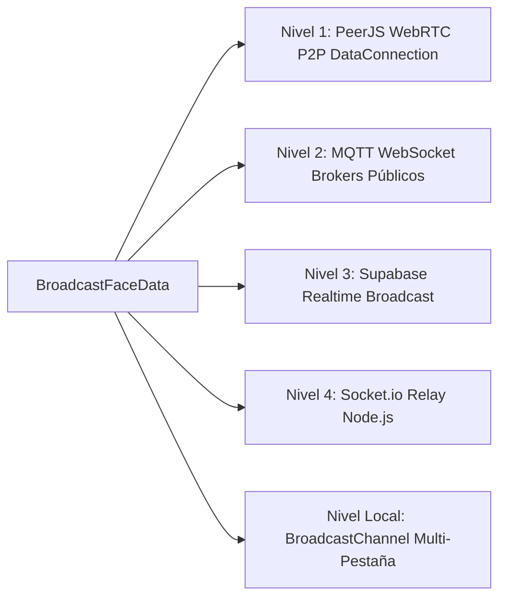
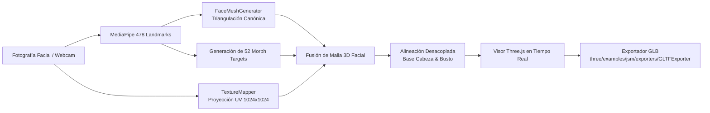

# Tech Reference: Arquitectura y Componentes de XStreamX

> **Documento:** Referencia Técnica y Arquitectura del Sistema (Tech Reference)  
> **Proyecto:** XStreamX (3D Avatar Telepresence & Collaborative Space)  
> **Licencia:** Apache License, Version 2.0  
> **Origen del Proyecto:** XStreamX ([Repositorio Privado](https://github.com/qwertyui1980/3dchat.git))  
> **Fecha de Emisión:** Octubre 2026  

---

## 1. Resumen Ejecutivo y Filosofía de Diseño

**XStreamX** es una plataforma de telepresencia, videollamadas privadas y espacios colaborativos virtuales basada en **avatares 3D biomiméticos en tiempo real**. A diferencia de los sistemas tradicionales de videoconferencia (Zoom, Google Meet, Microsoft Teams) que capturan, comprimen y transmiten flujos continuos de video de alto ancho de banda hacia servidores centrales, XStreamX implementa una **Arquitectura de Privacidad por Diseño (Privacy-by-Design) y Cero-Transmisión de Video**.

### Principios Fundamentales

1. **Edge AI & Ejecución 100% Lado Cliente:** La captura de cámara, la inferencia de visión por computadora (MediaPipe Face Landmarker con 478 puntos tridimensionales) y el cálculo de expresiones faciales se ejecutan íntegramente en el hardware local del usuario (navegador web vía WebAssembly y WebGL).
2. **Cero Fuga Biométrica:** La cámara real jamás transmite video ni fotogramas sin procesar hacia servidores o participantes remotos. Ningún buffer de píxeles sale del dispositivo para la animación del avatar.
3. **Flujo Ultraligero de Blendshapes (Micro-Stream):** En lugar de transmitir megabytes de video continuo, el cliente transmite únicamente una estructura compacta de coeficientes numéricos normalizados de blendshapes (ARKit 52) y vectores de orientación espacial (yaw, pitch, roll), consumiendo apenas **pocos cientos de bytes por fotograma** a ~35–60 FPS.
4. **Renderizado 3D Descentralizado:** Cada cliente receptor reconstruye y renderiza localmente los avatares 3D de los demás participantes usando Three.js y aceleración por GPU. Esto reduce drásticamente el consumo de ancho de banda, elimina los costos de transcodificación de video en el servidor y escala de manera horizontal.

```mermaid
flowchart TD
    subgraph Cliente Local (Emisor)
        Cam[Cámara Web Local] -->|Captura de Frames| MP[MediaPipe Face Landmarker\n478 Puntos 3D]
        Mic[Micrófono Local] -->|Análisis Web Audio API| WA[Volumen & Frecuencia]
        MP -->|Coordenadas Faciales| Mapper[ARKit Blendshape Mapper\n52 Coeficientes]
        Mapper --> Payload[Payload Ultraligero\n~300 bytes/frame]
        WA -.->|Lip-sync fallback| Payload
    end

    subgraph Red de Transporte Híbrida
        Payload --> P2P[PeerJS WebRTC Mesh\nCanal de Datos Directo]
        Payload --> MQTT[Broker MQTT WebSockets\nMesh Global de Respaldo]
        Payload --> Supa[Supabase Realtime\nCanal Broadcast]
        Payload --> Sock[Socket.io / Servidor Node.js\nSeñalización & Respaldo]
    end

    subgraph Clientes Remotos (Receptores)
        P2P & MQTT & Supa & Sock --> Sync[Recepción de Micro-Stream]
        Sync --> Interp[Interpolación & Damping]
        Interp --> Three[Motor Three.js WebGL]
        Three --> Screen[Renderizado 3D Local del Avatar]
    end
```

---

## 2. Pila Tecnológica (Tech Stack)

| Capa | Tecnología | Versión | Rol en el Sistema |
| :--- | :--- | :--- | :--- |
| **Runtime & Servidor** | Node.js + Express + `tsx` | 22.x / 4.21 | Servidor HTTP, middleware de señalización Socket.io y servidor de estáticos |
| **Frontend Framework** | React + TypeScript | React 19 / TS 7.0 | UI reactiva, estado de sala, gestión de hardware y modales |
| **Bundler & Build Tool**| Vite | 8.3 | Servidor de desarrollo HMR ultrarrápido y empaquetado de producción |
| **Motor Gráfico 3D** | Three.js | 0.186 | Escenas 3D, OrbitControls, morph targets, shaders, carga GLTF/OBJ/STL |
| **Visión Artificial** | `@mediapipe/tasks-vision` | 1.0.1 | Detección facial, 478 landmarks 3D y blendshapes en tiempo real en browser |
| **Audio Processing** | Web Audio API nativo | W3C Standard | Detección de volumen, audio reactivo y streaming WebRTC de voz |
| **Red P2P & Señalización**| PeerJS + Socket.io Client + MQTT | 1.5.5 / 4.8.4 / 5.16 | Malla de canales de datos de baja latencia y conmutación por error cuádruple |
| **Persistencia & Tiempo Real**| Supabase JS SDK + LocalStorage | 2.117 | Canales en tiempo real, registro de usuarios y fallback local |
| **Estilos & Animación** | Tailwind CSS v4 + Lucide React | 4.3.3 / 0.546 | Sistema de diseño oscuro premium, glassmorphism e iconografía |

---

## 3. Arquitectura de Red Híbrida Cuádruple (Quad-Mesh Network)

Para garantizar conexión ininterrumpida y resiliencia total contra fallas de cortafuegos o caídas de servidores, [`src/services/networkService.ts`](file:///d:/Apps/xstreamx/src/services/networkService.ts) implementa una **estrategia de transporte en 4 niveles concurrentes**:



1. **Nivel 1: PeerJS WebRTC Direct Mesh (P2P de latencia cero):**
   * Establece conexiones directas `DataConnection` (SCTP sobre DTLS) entre pares.
   * La voz se transmite mediante `MediaConnection` WebRTC directa cifrada punto a punto.
   * Proporciona la latencia más baja posible (~10–30 ms) sin costo de servidor.
2. **Nivel 2: Public MQTT WebSocket Mesh (Respaldo global de alta concurrencia):**
   * Conexión por WebSockets seguros (`wss://broker.emqx.io:8084/mqtt`, `wss://broker.hivemq.com:8884/mqtt`).
   * Patrón publicación/suscripción mediante temas de sala dinámicos (`xstreamx/rooms/{roomId}/features`).
   * Salta firewalls estrictos (NAT simétrico) sin requerir servidores TURN dedicados.
3. **Nivel 3: Supabase Realtime Channels:**
   * Utiliza WebSockets multiplexados de Supabase para eventos de presencia, sincronización de estado y difusión de eventos de administración.
4. **Nivel 4: Socket.io Central Server Relay:**
   * Fallback sobre el servidor Node.js/Express local (`server.ts`).
   * Se encarga de la negociación de salas, control de presencia, sincronización de video y expulsión de usuarios.
5. **Nivel Multi-Pestaña Local (`BroadcastChannel`):**
   * Canal nativo `xstreamx_mesh_channel` que permite sincronizar múltiples ventanas o pestañas en la misma máquina sin consumir ancho de banda de red.

---

## 4. Pipeline de Visión por Computadora y Animación Facial

El núcleo de animación biomimética reside en [`src/services/mediapipeService.ts`](file:///d:/Apps/xstreamx/src/services/mediapipeService.ts) y [`src/services/face3d/arkitMapper.ts`](file:///d:/Apps/xstreamx/src/services/face3d/arkitMapper.ts):

### 4.1. Detección y Extracción de Características
* MediaPipe procesa el feed de la cámara web a 60 FPS generando 478 puntos tridimensionales normalizados ($x, y, z$).
* Se calculan automáticamente:
  * **Apertura Ocular Izquierda/Derecha:** Distancia euclidiana entre párpados superiores e inferiores normalizada frente a la escala de la órbita ocular.
  * **Orientación Cefálica (Head Pose):** Ángulos de inclinación (*Pitch*), giro (*Yaw*) y ladeo (*Roll*) deducidos del vector normal del triángulo nariz-ojos.
  * **Apertura de Mandíbula y Boca:** Coordenadas de los labios interiores y comisuras para detectar sonrisas, muecas y silbidos.

### 4.2. Mapeador de 52 Blendshapes ARKit Estándar
[`ARKitBlendshapeMapper`](file:///d:/Apps/xstreamx/src/services/face3d/arkitMapper.ts) traduce la salida de MediaPipe al estándar universal de Apple ARKit:
* **Ojos (14):** `eyeBlinkLeft`, `eyeBlinkRight`, `eyeLookDownLeft`, `eyeLookDownRight`, `eyeLookInLeft`, `eyeLookInRight`, `eyeLookOutLeft`, `eyeLookOutRight`, `eyeLookUpLeft`, `eyeLookUpRight`, `eyeSquintLeft`, `eyeSquintRight`, `eyeWideLeft`, `eyeWideRight`.
* **Cejas (5):** `browDownLeft`, `browDownRight`, `browInnerUp`, `browOuterUpLeft`, `browOuterUpRight`.
* **Mandíbula (4):** `jawForward`, `jawLeft`, `jawRight`, `jawOpen`.
* **Boca (23):** `mouthClose`, `mouthFunnel`, `mouthPucker`, `mouthLeft`, `mouthRight`, `mouthSmileLeft`, `mouthSmileRight`, `mouthFrownLeft`, `mouthFrownRight`, `mouthDimpleLeft`, `mouthDimpleRight`, `mouthStretchLeft`, `mouthStretchRight`, `mouthRollLower`, `mouthRollUpper`, `mouthShrugLower`, `mouthShrugUpper`, `mouthPressLeft`, `mouthPressRight`, `mouthLowerDownLeft`, `mouthLowerDownRight`, `mouthUpperUpLeft`, `mouthUpperUpRight`.
* **Mejillas (3):** `cheekPuff`, `cheekSquintLeft`, `cheekSquintRight`.
* **Nariz (2):** `noseSneerLeft`, `noseSneerRight`.
### 4.3. Modos Oficiales de Animación Dinámica (`dynamicModeHelper.ts`)
El sistema implementa tres modos oficiales de animación de carácter, seleccionables tanto en el Lobby de bienvenida como en vivo durante la llamada:

1. **Modo Parafernalia (`parafernalia` - Voz, Ritmo & Zoom Dinámico):**
   * Modo dinámico y divertido de animación.
   * La máscara se mueve al unísono con el ritmo de la voz y los gestos de cámara.
   * **Zoom Dinámico Reactivo:** En [`ThreeAvatarCanvas.tsx`](file:///d:/Apps/xstreamx/src/components/avatars/ThreeAvatarCanvas.tsx), el eje focal de la cámara $Z$ ejecuta un zoom de aproximación suave e inmediato sobre los picos de intensidad vocal (`dynamicZoomOffset` hasta $+0.6$ unidades con ataque y decaimiento exponencial) complementado con una micro-cadencia rítmica de cabeceo al hablar.
2. **Modo Reconocimiento de Gestos (`gestures` - Visión 100% Cámara):**
   * Reconoce única y exclusivamente los gestos faciales y traslación de cabeza captados por la cámara con MediaPipe/ARKit y los replica fielmente en el avatar.
   * El audio del micrófono tiene cero influencia sobre la animación facial (`audioVolume: 0` forzado estrictamente), previniendo que sonidos del entorno deformen la boca o la mandíbula.
3. **Modo Lip Sync (`lipsync` - Solo Labios y Boca por Audio):**
   * La máscara se mantiene estática en posición neutral ($Yaw = 0, Pitch = 0, Roll = 0$, cejas y ojos neutros).
   * El flujo de audio del micrófono anima únicamente la sección de los labios y la apertura bucal en tiempo real.
   * **Cero requerimiento de detección de video:** No procesa ni necesita video de cámara; la animación bucal funciona 100% a partir del micrófono.

### 4.4. Persistencia y Activación de Opciones al Ingresar a la Sala
* Al pasar del Lobby al espacio de llamada (`RoomView`), se conservan y aplican automáticamente todas las configuraciones elegidas por el usuario:
  * **Estado de Micrófono:** Si el usuario desmuteó o muteó en el Lobby, ingresa en el mismo estado sin ser forzado a silencio.
  * **Estado de Cámara:** Respetado fielmente (activada o liberada).
  * **Modo Dinámico:** Mantiene la selección oficial (`parafernalia`, `gestures` o `lipsync`, con compatibilidad retroactiva hacia `hybrid`, `camera_only`, `audio_only`).
  * **Calibración y Centrado:** Los offsets en $X$ y $Y$, así como la sensibilidad de expresión, persisten en `localStorage` y se aplican al avatar local y su proyección en sala.
  * **Visor Anatómico (PIP):** Mantiene la visibilidad deseada del visor de tracking.

---

## 5. Motor Gráfico 3D y Generador de Personajes

Implementado en [`ThreeAvatarCanvas.tsx`](file:///d:/Apps/xstreamx/src/components/avatars/ThreeAvatarCanvas.tsx) y [`threeCharacterBuilder.ts`](file:///d:/Apps/xstreamx/src/components/avatars/threeCharacterBuilder.ts):

### 5.1. Tipos de Avatares Soportados
1. **Avatares Procedurales:**
   * `three_robot`: Humanoide mecatrónico procedural con visor LED, antenas dinámicas y emisivos reactivos a la voz.
   * `cat_3d`: Avatar estilizado de felino con orejas articuladas, bigotes y cinemática en párpados.
   * `lowpoly_human` / `anime_girl`: Mallas humanoides ligeras optimizadas para rendimiento móvil.
   * `neon_holo` (**Neon Cyber 3D**): Avatar holográfico vectorial de líneas de neón cian y labios azul eléctrico reactivo a todos los puntos anatómicos de tracking facial (48+ nodos). Incluye silueta craneal con partición de cabello, orejas redondeadas prominentes en laterales, hendidura frontal reactiva a elevación de cejas, cejas arqueadas dinámicas, ojos elípticos con pupilas que siguen la mirada (`gazeX/Y`) y parpadean (`blinkL/R`), trazo continuo nasal con rizo alar, labios azul neón reactivos a apertura bucal, sonrisa y fruncimiento (`jawOpen`, `mouthSmile`, `mouthPucker`), y contornos minimalistas de cuello vertical que se abren en hombros estilizados.
2. **Modelos 3D de Busto y Esculturas (OBJ, STL, GLB):**
   * Soporta carga de modelos históricos y escultóricos (`Bush_standard.stl`, `Jinping.obj`, `Ptin2.obj`, `Thatcher_bust.obj`) con normalización geométrica automática, corrección de normales y re-centrado respecto al origen.
3. **Avatares Personalizados 3D Masks:**
   * Mallas faciales generadas por el Administrador con mapeo de textura fotográfica y 52 morph targets.

### 5.2. Cinemática Orgánica del Torso y Busto
* A diferencia de cabezas flotantes estáticas, el sistema integra **cinemática bi-articular de torso**:
  * **Flexión de Cuello:** Distribución gradual de la rotación cefálica (70% en cráneo, 30% en vértebras cervicales).
  * **Balanceo de Hombros:** Reacción con retraso elástico (*spring physics*) al cabeceo lateral (*Roll*).

### 5.3. Centrado Vertical Unificado y Encuadre Retrato (Vertical Framing Standard)
* **Objetivo de Cámara Unificado ($y = 3.80$):**
  * La cámara de perspectiva (`FOV = 40°`, distancia $Z = 4.8$) enfoca permanentemente a $(0, 3.8, 0)$ con campo visual vertical de $y \in [2.05, 5.55]$.
* **Alineación Vertical de Personajes Iniciales y Procedurales:**
  * Para erradicar desajustes donde los personajes aparecían hundidos en la parte inferior de la tarjeta con espacio vacío superior, todos los personajes procedurales incorporan un contenedor de recentrado vertical (`contentGroup`) que eleva la anatomía de forma armónica:
    * `cat_3d` y `dog_3d`: Elevados $+0.58$ en $Y$ (centro facial alineado a $y = 3.78$).
    * `female_3d` (Chica Anime) y `fox_sensei` (Kitsune): Elevados $+0.55$ en $Y$ (centro facial a $y = 3.80$).
    * `horse_3d` (Caballo): Elevado $+0.65$ en $Y$ (compensa el hocico alargado descendente para situar el eje ocular y nasal entre $y = 3.55$ y $3.85$).
    * `buildProceduralRobotCharacter` (`cyber_nova`, `bot_9000`, `pixel_punk`): Elevados $+0.62$ en $Y$ (alinea la pantalla del visor a $y = 3.82$).
    * `mesh_outline` (Holo Mesh 3D) y `neon_holo` (Neon Cyber 3D): Elevados $+0.55$ en $Y$ (centra el óvalo facial en $y = 3.80$).
    * `three_robot` (`RobotExpressive.glb`): Posicionado en `clonedScene.position.set(0, 0.75, 0)` en [`ThreeAvatarCanvas.tsx`](file:///d:/Apps/xstreamx/src/components/avatars/ThreeAvatarCanvas.tsx), elevando el hueso `Head` de su posición de reposo ($y = 2.97$) hasta $y = 3.72$, encuadrando el visor y matriz LED bucal en el centro del viewport.
  * Todas las mallas anatómicas de torso descienden fluidamente más allá del borde inferior ($y < 2.05$), creando un encuadre de busto/retrato profesional sin recortes toscos ni desfasajes en los 478 puntos de tracking 3D.
### 5.4. Sincronización Universal de Boca y Mandíbula para Modelos 3D y Personalizados
* **Separación Topológica Estricta de Labios (`UPPER_LIP_SET` vs `LOWER_LIP_SET` vs `MOUTH_CORNER_SET`):**
  * Elimina landmarks mandibulares erróneos del labio superior (43, 83, 106, 182 devueltos a la mandíbula inferior) delimitando con precisión la hendidura interlabial.
  * **Efecto Habla Auténtico:** La boca se divide estrictamente desde el labio inferior hacia abajo:
    * El labio superior permanece **100% anclado al cráneo** (cero descenso vertical), actuando como el techo anatómico estable contra el cual el labio inferior se cierra al cesar el habla.
    * El labio inferior desciende con apertura nítida (-0.38 en Y, -0.12 en Z hacia la cavidad oral) con atenuación lateral armónica hacia las comisuras (61, 78, 291, 308).
    * La mandíbula y el mentón (landmark 152) articulan de forma continua (-0.24 en Y, -0.07 en Z) siguiendo la rotación mandibular sin saltos ni deformaciones puntiagudas.
    * Al hablar, no se fuerza elevación artificial de `mouthUpperUp`, preservando la estética natural de articulación bucal.
  * Extiende la segregación topológica a los blendshapes `mouthLowerDownLeft/Right`, `mouthUpperUpLeft/Right`, `mouthRollUpper/Lower` y `mouthClose`, eliminando cancelaciones mutuas en rostros con labios en reposo.
* **Auto-Reparación y Actualización en Caliente (Runtime Hot-Upgrade) en `ThreeAvatarCanvas.tsx`:**
  * Al cargar cualquier avatar personalizado previamente guardado (incluyendo modelos en LocalStorage como "busheshe"), el sistema detecta si el morph target `jawOpen` tiene una apertura deficiente o labio superior caído (`delta13 < -0.02` o `delta14 > -0.22`) y recalcula en caliente la apertura completa en memoria GPU respetando el estándar glTF (`morphTargetsRelative: true` con deltas vectoriales `(mx - bx, my - by, mz - bz)`), sin necesidad de re-generar ni re-subir el avatar.
* **Simulador de Efecto Habla en Estudio 3D Masks:**
  * Integra control de prueba interactivo (*Probar Habla*) en el modal de administración `FaceBlendshapeStudioModal.tsx` con modulación sinusoidal silábica (3–4 Hz) para previsualizar inmediatamente la separación del labio inferior hacia abajo y el cierre con el labio superior.
* **Sincronización Rígida de Cuello, Cavidad Oral y Ojos:**
  * Al mover o rotar la cabeza en avatares 3D Masks con busto, la cavidad oral anatómica (`oralCavityNode`), las arcadas dentales y los ojos (`eyesGroupNode`) se sincronizan rígidamente con la orientación y posición de `faceMeshNode`, erradicando desalineaciones al girar o inclinar el rostro.
  * La arcada dental inferior (`lowerTeeth`) desciende dinámicamente (-0.26 en Y, -0.10 en Z) con la mandíbula, revelando la cámara oral oscura y los dientes al hablar.
* **Cámara Oral Anatómica con Bloqueo de Transparencia (`generateOralCavityMesh`):**
  * Cavidad cilíndrica cerrada con placa dorsal oscura (`cavityBackPlate` en `#050102`), evitando que el modelo base de cabeza o polígonos traseros se visualicen a través de la boca abierta.
* **Fallback Procedural para Modelos 3D Estáticos (Sin Morph Targets ni Bones):**
  * Si un modelo importado carece de blendshapes y de huesos esqueléticos en la mandíbula, un algoritmo de deformación geométrica procedural desplaza los vértices inferiores del tercio mandibular en base a `finalJaw`, garantizando que ningún avatar parezca una imagen estática al hablar.
* **Resolución Inteligente de Nombres de Morph Targets:**
  * Remueve prefijos de malla (e.g. `Wolf3D_Avatar.jawOpen`, `CC_Base_Body:mouthOpen`, `Head.jaw`) y normaliza alias universales (`jawOpen`, `mouthOpen`, `mouth_open`, `jaw_open`, `jaw`, `open`, `viseme_aa`, `v_aa`, `aa`, `fcl_mth_o`).
* **Supresión Activa de Conflictos (`mouthClose`):**
  * Atenúa dinámicamente el blendshape `mouthClose` cuando `finalJaw > 0`, erradicando el conflicto biomecánico donde MediaPipe cerraba los labios mientras la mandíbula intentaba abrirse.
* **Apertura Articulada y Respuesta sin Lag:**
  * Factor de apertura calibrado (1.25x) con ataque directo e interpolación reactiva a 0.90 para sincronización labial nítida en tiempo real tanto por webcam como por audio lip-sync.

---

## 5.5. Pipeline Overhaul: Compatibilidad Total Avatares 3D Masks ↔ MediaPipe

### Fase 1 — `morphTargetsRelative = true` (glTF 2.0 estándar)
* [`faceMeshGenerator.ts`](file:///d:/Apps/xstreamx/src/services/face3d/faceMeshGenerator.ts): `geometry.morphTargetsRelative` cambiado de `false` → `true`.
* **Impacto:** Elimina deformaciones exageradas o invertidas al cargar avatares GLB en runtime. El estándar glTF 2.0 especifica que los morph targets son **deltas relativos** (`dx, dy, dz`); en modo `false`, el loader interpretaba los datos incorrectamente.

### Fase 2 — Morph Targets como Deltas Relativos
* `calculateMorphTarget()` ahora devuelve `(x−base.x, y−base.y, z−base.z)` en lugar de posiciones absolutas.
* Los 8 targets de mirada (`eyeLookUpLeft/Right`, `eyeLookDownLeft/Right`, `eyeLookInLeft/Right`, `eyeLookOutLeft/Right`) producen **delta=0** en la malla facial. La animación de gaze se delega 100% a los globos oculares 3D (`eyeLeft`/`eyeRight` nodes), eliminando el doble-conflicto de animación.

### Fase 3 — Calibración Serializada en GLB + neckPivot
* `exportGLB()` en [`faceToBlendshapeService.ts`](file:///d:/Apps/xstreamx/src/services/face3d/faceToBlendshapeService.ts) acepta `calibrationMeta` opcional y lo embebe en un nodo `xstreamx_meta` con `userData` (mouthParams, gestureParams, landmarksSampled comprimidos a cada 4° punto).
* Se añade nodo `neckPivot` (`Object3D`) a nivel de la barbilla para que `ThreeAvatarCanvas` distribuya la rotación entre cuello (35%) y cabeza (75%), produciendo movimiento orgánico.

### Fase 4 — Fallbacks ARKit Completos + Velocidades de Lerp Diferenciadas
* **`featureFallback`**: Mapa de 52 entradas ARKit derivado de `FaceFeatures` primitivos. Activo cuando `features.blendshapes` es `undefined` (modo lipsync/parafernalia) — la cara nunca queda inexpresiva.
* **Grupos de velocidad** en `morphTargetInfluences`:
  * `FAST_MORPH_KEYS` (`jawOpen`, `eyeBlinkLeft/Right`, `mouthClose`): speed 0.92 (ataque) / 0.82 (decaimiento) — respuesta instantánea para lip-sync y parpadeo.
  * `MEDIUM_MORPH_KEYS` (cejas, sonrisa, mejillas, nariz): speed 0.62 — fluidez expresiva.
  * Resto de morfos: speed 0.42 — transición suave.

### Fase 5 — Lectura de `xstreamx_meta` + Auto-Upgrade Mejorado
* Al cargar un GLB, `ThreeAvatarCanvas` busca el nodo `xstreamx_meta` y almacena sus `calibrationMeta` en `clonedScene.userData` para futuras re-ediciones en el estudio.
* El auto-upgrade de `jawOpen` para modelos legacy ahora siempre escribe deltas relativos (`mx−bx`), marca `fGeo.morphTargetsRelative = true` post-upgrade y mejora la detección de umbrales para modelos absolutos en LocalStorage.

### Fase 6 — Curvas de Sensibilidad No Lineal y Detección Geométrica Reforzada (`arkitMapper.ts`)
* MediaPipe genera puntuaciones crudas típicamente bajas (0.05 a 0.25) para cejas y sonrisas bajo iluminación y cámaras web ordinarias.
* **Curvas de Potencia Gamma y Ganancia Acelerada:**
  * Cejas: `Math.pow(val, 0.65) * 2.1` (`browInnerUp`, `browOuterUp*`, `browDown*`).
  * Sonrisas: `Math.pow(val, 0.70) * 1.85` (`mouthSmile*`).
  * Pucker / Beso: `Math.pow(val, 0.75) * 1.7` (`mouthPucker`).
  * Parpadeo: `val > 0.06 ? Math.min(1.0, (val - 0.06) * 2.2) : 0` (`eyeBlink*`).
* **`enhanceBlendshapesFromLandmarks`:** Reforzado con distancias euclidianas geométricas directas entre párpados y ratios labiales (apertura bucal $ratio > 0.08$ activa `jawOpen`, altura de comisuras activa sonrisa o tristeza).

### Fase 7 — Garantía de Recorrido Ocular Mínimo y Desplazamiento Frontal en Párpados (`faceMeshGenerator.ts`)
* En modelos fotogramétricos con hendidura palpebral estrecha o máscaras (e.g. Bolsonaro), el cálculo tradicional de distancia entre párpados superior e inferior arrojaba un delta ínfimo ($dy \approx -0.06$), impidiendo que el párpado superior cubriera el globo ocular.
* **Garantía de Stroke Mínimo:** Forzado a `strokeDy = Math.min(rawDy * 1.15, -0.24)`, asegurando un descenso mínimo de $-0.24$ unidades con curvatura frontal en Z ($+0.05$) para cerrar limpiamente sobre la esfera del ojo 3D.
* **Amplitud Aumentada:** Elevación central de cejas hasta 0.30, ceño fruncido hasta 0.25, sonrisa hasta 0.30, comisuras tristes hasta 0.24 y pucker hasta 0.55/0.24.

### Fase 8 — Auto-Upgrade Universal de 52 Morfos Legacy en Runtime (`ThreeAvatarCanvas.tsx`)
* **Detección y Conversión Automática de Coordenadas Absolutas:** Cualquier avatar legacy en `localStorage` con vértices en modo absoluto se convierte en caliente a deltas relativos `(morphAttr - posAttr)` marcando `morphTargetsRelative = true`.
* **Amplificación Dinámica de Trazos Antiguos:** Auto-escala los deltas de párpados (`eyeBlink*`), cejas (`browInnerUp`) y sonrisas si detecta que el modelo guardado tiene rangos insuficientes.
* **Cinemática de Arcada Dental Inferior Relativa a Baseline:** `lowerTeeth` desciende de forma relativa a su posición inicial (`initialTeethPos.y - finalJaw * 0.18`), erradicando saltos a la nariz o al puente facial.
* **Sincronización en Loop sin Cortocircuitos:** En `controller.update`, los blendshapes crudos y las features geométricas se combinan mediante `Math.max()` y multiplicadores de ganancia, evitando que valores residuales anulen las expresiones.
* **Seguimiento de Mirada 3D Amplificado:** Multiplicadores aumentados a `gazeX * 0.70` y `gazeY * 0.55`.

### Fase 9 — Acople de Sliders y Cinemática en el Estudio (`FaceBlendshapeStudioModal.tsx`)
* Los sliders manuales de blendshapes `eyeLook*` ahora llaman directamente a `eyePairResultRef.current.updateGaze`, moviendo las pupilas y globos oculares 3D en tiempo real.
* La posición de `lowerTeeth` en la prueba de habla, en el tracking en vivo y en los sliders se sincroniza congruentemente con `lowerTeeth.userData.basePos`.

---

## 6. Estudio de Generación de Avatares 3D Masks (Face to Blendshape Studio)

Ubicado en [`src/components/admin/FaceBlendshapeStudioModal.tsx`](file:///d:/Apps/xstreamx/src/components/admin/FaceBlendshapeStudioModal.tsx) y [`src/services/face3d/faceToBlendshapeService.ts`](file:///d:/Apps/xstreamx/src/services/face3d/faceToBlendshapeService.ts):



### Características Técnicas del Estudio:
* **Generación a partir de Foto Única:** Genera una malla de 478 vértices y ~900 triángulos texturizada por coordenadas UV calculadas sobre el rostro con normalización ortonormal frontal canónica.
* **Sistema de Ojos 3D Biomiméticos con Seguimiento por Webcam (`EyeGenerator`):**
  * Genera esferas oculares tridimensionales con esclera PBR cálida, estroma de iris procedural multiradial de 512x512 y **pupila física 3D independiente con color personalizable** (`${name}_pupil`) con contraste absoluto, calibración de escala (`pupilSize`) y color libre/presets (`pupilColor`), eliminando cataratas o reflejos blanquecinos y garantizando visibilidad 100% nítida bajo cualquier ángulo o iluminación.
  * Córnea vítrea sutil no oclusiva con `depthWrite: false` orientada frontalmente en +Z para preservar el relieve del iris y la pupila.
  * **Seguimiento Ocular en Tiempo Real:** Las esferas rotan dinámicamente en Yaw (±26°) y Pitch (±20°) acopladas a la mirada del usuario capturada por la webcam mediante los puntos de iris MediaPipe (468 y 473) y blendshapes ARKit (`eyeLook*`), tanto en el visor de administración como en todas las salas de videoconferencia a través de [`threeCharacterBuilder.ts`](file:///d:/Apps/xstreamx/src/components/avatars/threeCharacterBuilder.ts).
  * **Paletas de Color y Presets:**
    * 8 presets de Iris (`IRIS_COLOR_PRESETS`) y selector libre RGB.
    * 8 presets de Pupila (`PUPIL_COLOR_PRESETS`: Negro Obsidiana, Rojo Carmesí, Púrpura Místico, Azul Abisal, Ámbar Felino, Verde Esmeralda, Gris Grafito, Blanco Fantasma) y selector libre RGB.
    * Slider de **Tamaño de Pupila** (18% a 55% del radio de iris) con actualización sincronizada en la textura y el disco 3D físico.
* **Eliminación del Torso / Busto en Máscaras 3D (Clean Facial Mask Architecture):**
  * El pipeline de generación y exportación de 3D Masks se enfoca exclusivamente en la anatomía craneofacial pura: Malla facial 3D + Cráneo base + Ojos biomiméticos 3D + Cavidad oral y dientes.
  * El busto y vestimenta ejecutiva (`BustGenerator`) han sido completamente eliminados de la generación y exportación de máscaras, optimizando la ligereza del archivo `.glb`, mejorando el encuadre vertical de retrato en [`ThreeAvatarCanvas.tsx`](file:///d:/Apps/xstreamx/src/components/avatars/ThreeAvatarCanvas.tsx) y eliminando oclusiones innecesarias.
* **Plano de Foto de Referencia Estabilizado en el Visor 3D (`referencePhotoPlane`):**
  * Posicionado de forma segura detrás del cráneo a $Z = -1.60$ con `renderOrder: -1` y `depthWrite: false`, eliminando z-clipping y oclusiones contra la cabeza o la malla facial.
  * Ciclo de vida desacoplado: La geometría y la textura WebGL se crean una sola vez al cargar la imagen y persisten de forma estable. Los cambios de opacidad (`photoPlaneOpacity`) y visibilidad (`showPhotoPlane`) se aplican directamente en las propiedades del material sin recrear mallas ni desechar texturas en GPU.
  * Preservación en Re-inicialización: Si la escena Three.js se reconstruye o se reabre el modal, `photoPlaneRef.current` se vuelve a añadir automáticamente a la escena activa sin perder la imagen original.
* **Material Facial PBR Ocluyente y Sólido (`FaceMeshGenerator`):**
  * Configurado con `transparent: false` y `depthWrite: true`, asegurando que el exportador Three.js `GLTFExporter` no asigne `alphaMode: BLEND` al exportar, erradicando transparencias accidentales o pérdida de la textura facial contra planos de fondo.
* **Diseño 100% Responsive al Ancho del Navegador:**
  * El modal del estudio (`FaceBlendshapeStudioModal.tsx`) elimina las restricciones estáticas (`max-w-6xl`) y se expande fluidamente cubriendo hasta el `99vw` (con límite de confort en `2400px` para monitores ultra-wide y 4K).
  * Arquitectura Flexbox adaptable: La columna central del visor 3D Three.js se define con `flex-1 min-w-0`, consumiendo dinámicamente todo el ancho disponible del navegador mientras los paneles laterales (panel de carga de foto/webcam y panel de sliders/blendshapes) mantienen proporciones optimizadas y confortables.
  * Sincronización continua mediante `ResizeObserver`: El viewport WebGL y la cámara de perspectiva Three.js recalculan al vuelo el `aspect ratio` y el `setSize(w, h, false)` ante cualquier cambio en el ancho o alto de la ventana del navegador, sin saltos visuales ni deformaciones de perspectiva.
* **Alineación Desacoplada en 5 Vías:** Panel de calibración con selectores dedicados para *Malla Facial*, *Boca y Labios*, *Ojos 3D*, *Base de Cabeza* y *Gestos 478*.
* **Espejo Webcam en Vivo (Live Mirror):** Prueba interactiva en tiempo real donde la cara, ojos y cabeza del usuario animan el avatar antes de guardarlo.
* **Exportación Estándar GLB:** Genera archivos `.glb` con textura UV sólida de 1024x1024, materiales físicos PBR, clonación aislada de materiales para evitar mutaciones en el visor, ojos 3D, cavidad oral y los 52 morph targets listos para su uso en Unity, Unreal Engine, Blender o la propia plataforma.

### 6.1. Control de Acceso y Permisos en el Lobby (`Lobby.tsx`):
* **Exclusividad para Administrador (`role: 'admin'`):**
  * La creación de avatares fotogramétricos biomiméticos mediante foto (`+ Foto 3D` / `Face to 3D`) y la importación de nuevos modelos 3D (`Subir 3D` / `Gestionar Modelos`) están restringidas estrictamente a administradores autenticados.
  * Para los participantes estándar, el Lobby presenta una cuadrícula limpia de avatares sin botones de creación o subida ni accesos directos de eliminación con "X", garantizando una experiencia de usuario despejada y segura contra borrados accidentales.
  * La gestión y eliminación autorizada de modelos permanece centralizada para el administrador dentro del panel `AdminControlPanel`.

### 6.2. Bloqueo de Avatar por Sesión (Sin Hot-Swap en Sala)
* El cambio de avatar **en vivo dentro de la sala ha sido eliminado** deliberadamente de [`CallControls.tsx`](file:///d:/Apps/xstreamx/src/components/room/CallControls.tsx) para garantizar la **consistencia de identidad** del personaje durante toda la llamada.
* El avatar se selecciona en el Lobby antes de unirse y permanece fijo para esa sesión. Esto evita:
  * Inconsistencias visuales momentáneas durante la recarga del modelo 3D.
  * Re-inicialización del pipeline de morph targets en medio de una conversación.
  * Confusión en los participantes remotos al ver un cambio de identidad repentino.
* Para cambiar de avatar, el usuario debe abandonar la sala, seleccionar un nuevo avatar en el Lobby y volver a unirse.

---

## 7. Módulos Interactivos de Sala

### 7.1. Home Theater y Reproductor Sincronizado de YouTube
* [`YouTubeSyncPlayer.tsx`](file:///d:/Apps/xstreamx/src/components/theater/YouTubeSyncPlayer.tsx) y [`HomeTheaterWindow.tsx`](file:///d:/Apps/xstreamx/src/components/theater/HomeTheaterWindow.tsx):
  * Utiliza la API IFrame de YouTube con control estricto de tiempo de reproducción.
  * Algoritmo de sincronización con tolerancia de desviación (*drift threshold*) de 1.5 segundos: solo aplica `seekTo` si el desfasaje supera el umbral, previniendo stuttering.
  * Cola colaborativa de videos con soporte para saltar, pausar y reproducción sincronizada multi-usuario gobernada por el administrador.
  * En la barra de control de llamada ([`CallControls.tsx`](file:///d:/Apps/xstreamx/src/components/room/CallControls.tsx)), el botón de reapertura de pantalla se titula **Video** (reemplazando la etiqueta anterior *Pantalla*).

### 7.2. Pizarra Colaborativa (Whiteboard)
* [`WhiteboardPanel.tsx`](file:///d:/Apps/xstreamx/src/components/whiteboard/WhiteboardPanel.tsx):
  * Lienzo interactivo basado en HTML5 Canvas con soporte para trazos vectoriales, formas geométricas, texto y colores.
  * Transmisión de trazos en tiempo real vía `WhiteboardStroke` distribuidos a través del canal de red híbrido.

---

## 8. Servidor de Señalización y Ciclo de Vida de Sala (`server.ts`)

* **Control de Presencia Unificada:** Implementa `rooms = new Map<string, Room>()` con persistencia en memoria y reconexión rápida.
* **Cierre Autoritativo de Sala por Salida del Administrador:**
  * Si el usuario con rol `admin` abandona la sala o desconecta su socket, el servidor emite inmediatamente el evento `room_closed` a todos los clientes.
  * Todos los participantes son devueltos de forma limpia al lobby y se cierran todos los streams de hardware (cámara y micrófono).

---

## 9. Seguridad, Cumplimiento y Marco Legal

| Aspecto | Implementación Técnica | Documento de Respaldo |
| :--- | :--- | :--- |
| **Licencia de Código Abierto** | Licencia **Apache 2.0** con apéndice de privacidad y cláusula de atribución obligatoria | [`LICENSE`](file:///d:/Apps/xstreamx/LICENSE) |
| **Privacidad Biométrica** | Procesamiento en el borde (*Edge Computing*); cero almacenamiento o transmisión de imágenes de cámara | [`Login.tsx`](file:///d:/Apps/xstreamx/src/components/auth/Login.tsx) |
| **Atribución de Origen** | Requisito expreso de conservar *"Origin: Originally created and developed by XStreamX"* | [`LegalDisclaimerModal.tsx`](file:///d:/Apps/xstreamx/src/components/common/LegalDisclaimerModal.tsx) |
| **Gestión de Hardware** | Liberación proactiva y segura de pistas `MediaStreamTrack.stop()` al abandonar llamadas | [`src/App.tsx`](file:///d:/Apps/xstreamx/src/App.tsx) |
| **Repositorio Fuente** | Desarrollo privado centralizado en `https://github.com/qwertyui1980/3dchat.git` | [`package.json`](file:///d:/Apps/xstreamx/package.json) |

---

## 10. Estructura de Directorios del Código Fuente

```text
xstreamx/
├── public/                       # Activos estáticos públicos
│   ├── models/                   # Modelos 3D (OBJ, STL, GLTF, GLB)
│   ├── favicon.svg               # Identidad gráfica
│   └── 404.html                  # Soporte SPA para GitHub Pages / subrutas
├── src/                          # Código fuente principal de la aplicación
│   ├── App.tsx                   # Controlador maestro de estado, sala y hardware
│   ├── main.tsx                  # Punto de entrada de renderizado React
│   ├── index.css                 # Estilos globales y utilidades Tailwind
│   ├── types/                    # Definiciones de tipos TypeScript globales
│   ├── components/
│   │   ├── admin/                # FaceBlendshapeStudioModal (Estudio 3D de avatares)
│   │   ├── auth/                 # Login (Controlador de acceso, modal de credenciales y privacidad)
│   │   ├── home/                 # PresidentesNeonHome (Landing con figuras neón, glitch aleatorio por figura Y por letra individual)
│   │   ├── avatars/              # ThreeAvatarCanvas, threeCharacterBuilder, configs
│   │   ├── common/               # Header, LegalDisclaimerModal, StarfieldBackground
│   │   ├── lobby/                # Lobby interactivo de entrada y selección de avatar
│   │   ├── room/                 # RoomView, CallControls, VideoGrid, ChatSidebar
│   │   ├── theater/              # YouTubeSyncPlayer, HomeTheaterWindow, QueueModal
│   │   ├── tracking/             # FaceTrackingVisionModule
│   │   └── whiteboard/           # WhiteboardPanel (Pizarra interactiva sincronizada)
│   ├── services/
│   │   ├── audioService.ts       # Web Audio API, análisis de volumen y muting
│   │   ├── mediapipeService.ts   # MediaPipe Face Landmarker y tracking 60 FPS
│   │   ├── networkService.ts     # Quad-Mesh networking (PeerJS, MQTT, Supabase, Socket)
│   │   ├── dbService.ts          # Gestión de usuarios, salas y persistencia
│   │   ├── supabaseClient.ts     # Cliente y canales broadcast de Supabase
│   │   └── face3d/               # Pipeline de reconstrucción 3D (ARKit, mesh, UV, bust)
│   └── utils/
│       ├── assetUrl.ts           # Resuelve rutas absolutas/relativas en subcarpetas
│       └── youtube.ts            # Utilidades de parsing y validación de IDs de YouTube
├── LICENSE                       # Licencia Apache 2.0 con apéndice de privacidad
├── README.md                     # Resumen de proyecto y arranque rápido
├── package.json                  # Dependencias, scripts y metadatos
├── server.ts                     # Servidor Node.js Express + Socket.io en tiempo real
├── supabase_schema.sql           # Esquema de base de datos PostgreSQL / Supabase
└── vite.config.ts                # Configuración de compilación Vite
```
