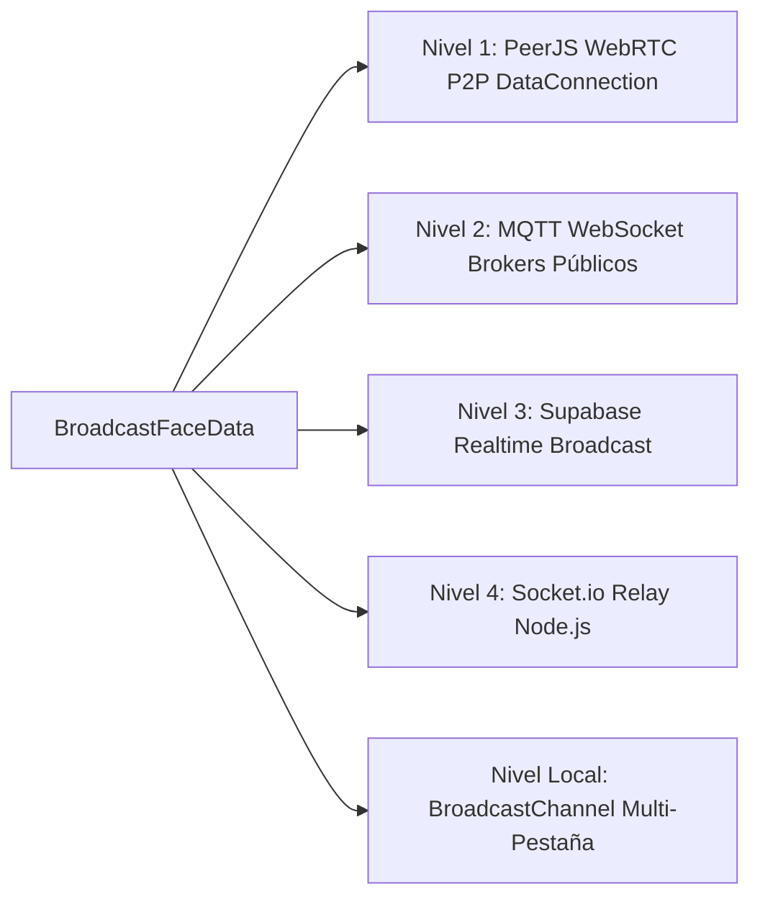
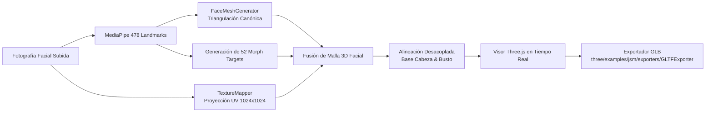

# Tech Reference: Arquitectura y Componentes de XStreamX

> **Documento:** Referencia Técnica y Arquitectura del Sistema (Tech Reference)  
> **Proyecto:** XStreamX (3D Avatar Telepresence & Collaborative Space)  
> **Licencia:** Apache License, Version 2.0  
> **Origen del Proyecto:** XStreamX ([Repositorio Privado](https://github.com/qwertyui1980/3dchat.git))  
> **Fecha de Emisión:** Octubre 2026  

---

## 1. Resumen Ejecutivo y Filosofía de Diseño

**XStreamX** es una plataforma de telepresencia, videollamadas privadas y espacios colaborativos virtuales basada en **avatares 3D biomiméticos en tiempo real**. A diferencia de los sistemas tradicionales de videoconferencia (Zoom, Google Meet, Microsoft Teams) que capturan, comprimen y transmiten flujos continuos de video de alto ancho de banda hacia servidores centrales, XStreamX implementa una **Arquitectura de Privacidad por Diseño (Privacy-by-Design) y Cero-Transmisión de Video**.

### Principios Fundamentales

1. **Edge AI & Ejecución 100% Lado Cliente:** La captura de cámara, la inferencia de visión por computadora (MediaPipe Face Landmarker con 478 puntos tridimensionales) y el cálculo de expresiones faciales se ejecutan íntegramente en el hardware local del usuario (navegador web vía WebAssembly y WebGL).
2. **Cero Fuga Biométrica:** La cámara real jamás transmite video ni fotogramas sin procesar hacia servidores o participantes remotos. Ningún buffer de píxeles sale del dispositivo para la animación del avatar.
3. **Flujo Ultraligero de Blendshapes (Micro-Stream):** En lugar de transmitir megabytes de video continuo, el cliente transmite únicamente una estructura compacta de coeficientes numéricos normalizados de blendshapes (ARKit 52) y vectores de orientación espacial (yaw, pitch, roll), consumiendo apenas **pocos cientos de bytes por fotograma** a ~35–60 FPS.
4. **Renderizado 3D Descentralizado:** Cada cliente receptor reconstruye y renderiza localmente los avatares 3D de los demás participantes usando Three.js y aceleración por GPU. Esto reduce drásticamente el consumo de ancho de banda, elimina los costos de transcodificación de video en el servidor y escala de manera horizontal.

```mermaid
flowchart TD
    subgraph Cliente Local (Emisor)
        Cam[Cámara Web Local] -->|Captura de Frames| MP[MediaPipe Face Landmarker\n478 Puntos 3D]
        Mic[Micrófono Local] -->|Análisis Web Audio API| WA[Volumen & Frecuencia]
        MP -->|Coordenadas Faciales| Mapper[ARKit Blendshape Mapper\n52 Coeficientes]
        Mapper --> Payload[Payload Ultraligero\n~300 bytes/frame]
        WA -.->|Lip-sync fallback| Payload
    end

    subgraph Red de Transporte Híbrida
        Payload --> P2P[PeerJS WebRTC Mesh\nCanal de Datos Directo]
        Payload --> MQTT[Broker MQTT WebSockets\nMesh Global de Respaldo]
        Payload --> Supa[Supabase Realtime\nCanal Broadcast]
        Payload --> Sock[Socket.io / Servidor Node.js\nSeñalización & Respaldo]
    end

    subgraph Clientes Remotos (Receptores)
        P2P & MQTT & Supa & Sock --> Sync[Recepción de Micro-Stream]
        Sync --> Interp[Interpolación & Damping]
        Interp --> Three[Motor Three.js WebGL]
        Three --> Screen[Renderizado 3D Local del Avatar]
    end
```

---

## 2. Pila Tecnológica (Tech Stack)

| Capa | Tecnología | Versión | Rol en el Sistema |
| :--- | :--- | :--- | :--- |
| **Runtime & Servidor** | Node.js + Express + `tsx` | 22.x / 4.21 | Servidor HTTP, middleware de señalización Socket.io y servidor de estáticos |
| **Frontend Framework** | React + TypeScript | React 19 / TS 7.0 | UI reactiva, estado de sala, gestión de hardware y modales |
| **Bundler & Build Tool**| Vite | 8.3 | Servidor de desarrollo HMR ultrarrápido y empaquetado de producción |
| **Motor Gráfico 3D** | Three.js | 0.186 | Escenas 3D, OrbitControls, morph targets, shaders, carga GLTF/OBJ/STL |
| **Visión Artificial** | `@mediapipe/tasks-vision` | 1.0.1 | Detección facial, 478 landmarks 3D y blendshapes en tiempo real en browser |
| **Audio Processing** | Web Audio API nativo | W3C Standard | Detección de volumen, audio reactivo y streaming WebRTC de voz |
| **Red P2P & Señalización**| PeerJS + Socket.io Client + MQTT | 1.5.5 / 4.8.4 / 5.16 | Malla de canales de datos de baja latencia y conmutación por error cuádruple |
| **Persistencia & Tiempo Real**| Supabase JS SDK + LocalStorage | 2.117 | Canales en tiempo real, registro de usuarios y fallback local |
| **Estilos & Animación** | Tailwind CSS v4 + Lucide React | 4.3.3 / 0.546 | Sistema de diseño oscuro premium, glassmorphism e iconografía |

---

## 3. Arquitectura de Red Híbrida Cuádruple (Quad-Mesh Network)

Para garantizar conexión ininterrumpida y resiliencia total contra fallas de cortafuegos o caídas de servidores, [`src/services/networkService.ts`](file:///d:/Apps/xstreamx/src/services/networkService.ts) implementa una **estrategia de transporte en 4 niveles concurrentes**:



1. **Nivel 1: PeerJS WebRTC Direct Mesh (P2P de latencia cero):**
   * Establece conexiones directas `DataConnection` (SCTP sobre DTLS) entre pares.
   * La voz se transmite mediante `MediaConnection` WebRTC directa cifrada punto a punto.
   * Proporciona la latencia más baja posible (~10–30 ms) sin costo de servidor.
2. **Nivel 2: Public MQTT WebSocket Mesh (Respaldo global de alta concurrencia):**
   * Conexión por WebSockets seguros (`wss://broker.emqx.io:8084/mqtt`, `wss://broker.hivemq.com:8884/mqtt`).
   * Patrón publicación/suscripción mediante temas de sala dinámicos (`xstreamx/rooms/{roomId}/features`).
   * Salta firewalls estrictos (NAT simétrico) sin requerir servidores TURN dedicados.
3. **Nivel 3: Supabase Realtime Channels:**
   * Utiliza WebSockets multiplexados de Supabase para eventos de presencia, sincronización de estado y difusión de eventos de administración.
4. **Nivel 4: Socket.io Central Server Relay:**
   * Fallback sobre el servidor Node.js/Express local (`server.ts`).
   * Se encarga de la negociación de salas, control de presencia, sincronización de video y expulsión de usuarios.
5. **Nivel Multi-Pestaña Local (`BroadcastChannel`):**
   * Canal nativo `xstreamx_mesh_channel` que permite sincronizar múltiples ventanas o pestañas en la misma máquina sin consumir ancho de banda de red.

### 3.1. Sincronización Automática P2P y Relay de Modelos 3D Personalizados (3ds Max / Custom Models)
* **Problema Resuelto:** Los modelos 3D creados o importados por los usuarios (archivos `.obj`, `.stl`, `.glb`, `.gltf` exportados desde 3ds Max, Blender o el Estudio 3D) residían originalmente únicamente en el `IndexedDB` / almacenamiento local del usuario emisor, impidiendo que los demás participantes de la sala de chat pudieran visualizarlos.
* **Protocolo de Detección y Solicitud Bajo Demanda:**
  * Al unirse un participante (`user_joined`, `presence_sync` o al montarse `ParticipantCard`), el cliente receptor evalúa si el `avatarId` corresponde a un modelo ausente localmente.
  * Si el modelo no existe, emite `requestAvatarModel(targetUserId, avatarId)` a través de la conexión directa `PeerJS DataConnection`, con fallback hacia Socket.io (`request_avatar_model`) y MQTT Mesh.
* **Empaquetado y Entrega Binaria:**
  * El usuario poseedor del modelo extrae el binario y metadatos (`avatarModelServiceSingleton.getModelDataForSync`) y lo transmite al solicitante con búfer binario de hasta 50MB.
* **Ingesta Dinámica e Invocación en Caliente:**
  * El cliente receptor registra el modelo en caliente con `avatarModelServiceSingleton.registerRemoteAvatar`, generando un `Blob` de objeto en memoria, guardando en caché local en IndexedDB y disparando el listener reactivo de `ThreeAvatarCanvas`, que carga y anima inmediatamente el avatar en pantalla sin requerir reinicio de la llamada.

---

## 4. Pipeline de Visión por Computadora y Animación Facial

El núcleo de animación biomimética reside en [`src/services/mediapipeService.ts`](file:///d:/Apps/xstreamx/src/services/mediapipeService.ts) y [`src/services/face3d/arkitMapper.ts`](file:///d:/Apps/xstreamx/src/services/face3d/arkitMapper.ts):

### 4.1. Detección y Extracción de Características
* MediaPipe procesa el feed de la cámara web a 60 FPS generando 478 puntos tridimensionales normalizados ($x, y, z$).
* **Alojamiento Local del Modelo de Tareas (`face_landmarker.task`):**
  * Para evitar fallos de protocolo HTTP/3 QUIC (`net::ERR_QUIC_PROTOCOL_ERROR`) provocados por proxies, cortafuegos o bloqueos UDP hacia `storage.googleapis.com`, el binario compilado de MediaPipe (`face_landmarker.task`, ~3.7 MB) se distribuye localmente en `public/wasm/` y se resuelve dinámicamente mediante `getAssetUrl('wasm/face_landmarker.task')`, garantizando carga instantánea sin dependencia de CDN externa y con fallback transparente.
* **Resolución Universal de Activos en Subrutas (`getAssetUrl`):**
  * Toda referencia a imágenes (`images/photoreal_...`, `images/dark_brick_wall.jpg`) y modelos 3D base (`models/head.glb`) se canaliza mediante `getAssetUrl` para garantizar compatibilidad con subdirectorios de despliegue (ej. `/3dchat/` o GitHub Pages) evitando errores 404 por rutas absolutas en raíz de dominio.
* Se calculan automáticamente:
  * **Apertura Ocular Izquierda/Derecha:** Distancia euclidiana entre párpados superiores e inferiores normalizada frente a la escala de la órbita ocular.
  * **Orientación Cefálica (Head Pose):** Ángulos de inclinación (*Pitch*), giro (*Yaw*) y ladeo (*Roll*) deducidos del vector normal del triángulo nariz-ojos.
  * **Apertura de Mandíbula y Boca:** Coordenadas de los labios interiores y comisuras para detectar sonrisas, muecas y silbidos.

### 4.2. Mapeador de 52 Blendshapes ARKit Estándar
[`ARKitBlendshapeMapper`](file:///d:/Apps/xstreamx/src/services/face3d/arkitMapper.ts) traduce la salida de MediaPipe al estándar universal de Apple ARKit:
* **Ojos (14):** `eyeBlinkLeft`, `eyeBlinkRight`, `eyeLookDownLeft`, `eyeLookDownRight`, `eyeLookInLeft`, `eyeLookInRight`, `eyeLookOutLeft`, `eyeLookOutRight`, `eyeLookUpLeft`, `eyeLookUpRight`, `eyeSquintLeft`, `eyeSquintRight`, `eyeWideLeft`, `eyeWideRight`.
* **Cejas (5):** `browDownLeft`, `browDownRight`, `browInnerUp`, `browOuterUpLeft`, `browOuterUpRight`.
* **Mandíbula (4):** `jawForward`, `jawLeft`, `jawRight`, `jawOpen`.
* **Boca (23):** `mouthClose`, `mouthFunnel`, `mouthPucker`, `mouthLeft`, `mouthRight`, `mouthSmileLeft`, `mouthSmileRight`, `mouthFrownLeft`, `mouthFrownRight`, `mouthDimpleLeft`, `mouthDimpleRight`, `mouthStretchLeft`, `mouthStretchRight`, `mouthRollLower`, `mouthRollUpper`, `mouthShrugLower`, `mouthShrugUpper`, `mouthPressLeft`, `mouthPressRight`, `mouthLowerDownLeft`, `mouthLowerDownRight`, `mouthUpperUpLeft`, `mouthUpperUpRight`.
* **Mejillas (3):** `cheekPuff`, `cheekSquintLeft`, `cheekSquintRight`.
* **Nariz (2):** `noseSneerLeft`, `noseSneerRight`.
### 4.3. Modos Oficiales de Animación Dinámica (`dynamicModeHelper.ts`)
El sistema implementa tres modos oficiales de animación de carácter, seleccionables tanto en el Lobby de bienvenida como en vivo durante la llamada:

1. **Modo Parafernalia (`parafernalia` - Voz, Ritmo & Zoom Dinámico):**
   * Modo dinámico y divertido de animación.
   * La máscara se mueve al unísono con el ritmo de la voz y los gestos de cámara.
   * **Zoom Dinámico Reactivo:** En [`ThreeAvatarCanvas.tsx`](file:///d:/Apps/xstreamx/src/components/avatars/ThreeAvatarCanvas.tsx), el eje focal de la cámara $Z$ ejecuta un zoom de aproximación suave e inmediato sobre los picos de intensidad vocal (`dynamicZoomOffset` hasta $+0.6$ unidades con ataque y decaimiento exponencial) complementado con una micro-cadencia rítmica de cabeceo al hablar.
2. **Modo Reconocimiento de Gestos (`gestures` - Visión 100% Cámara):**
   * Reconoce única y exclusivamente los gestos faciales y traslación de cabeza captados por la cámara con MediaPipe/ARKit y los replica fielmente en el avatar.
   * El audio del micrófono tiene cero influencia sobre la animación facial (`audioVolume: 0` forzado estrictamente), previniendo que sonidos del entorno deformen la boca o la mandíbula.
3. **Modo Lip Sync (`lipsync` - Solo Labios y Boca por Audio):**
   * La máscara se mantiene estática en posición neutral ($Yaw = 0, Pitch = 0, Roll = 0$, cejas y ojos neutros).
   * El flujo de audio del micrófono anima únicamente la sección de los labios y la apertura bucal en tiempo real.
   * **Cero requerimiento de detección de video:** No procesa ni necesita video de cámara; la animación bucal funciona 100% a partir del micrófono.

### 4.4. Persistencia y Activación de Opciones al Ingresar a la Sala
* Al pasar del Lobby al espacio de llamada (`RoomView`), se conservan y aplican automáticamente todas las configuraciones elegidas por el usuario:
  * **Estado de Micrófono:** Si el usuario desmuteó o muteó en el Lobby, ingresa en el mismo estado sin ser forzado a silencio.
  * **Estado de Cámara:** Respetado fielmente (activada o liberada).
  * **Modo Dinámico:** Mantiene la selección oficial (`parafernalia`, `gestures` o `lipsync`, con compatibilidad retroactiva hacia `hybrid`, `camera_only`, `audio_only`).
  * **Calibración y Centrado:** Los offsets en $X$ y $Y$, así como la sensibilidad de expresión, persisten en `localStorage` y se aplican al avatar local y su proyección en sala.
  * **Visor Anatómico (PIP):** Mantiene la visibilidad deseada del visor de tracking.

---

## 5. Motor Gráfico 3D y Generador de Personajes

Implementado en [`ThreeAvatarCanvas.tsx`](file:///d:/Apps/xstreamx/src/components/avatars/ThreeAvatarCanvas.tsx) y [`threeCharacterBuilder.ts`](file:///d:/Apps/xstreamx/src/components/avatars/threeCharacterBuilder.ts):

### 5.1. Tipos de Avatares Soportados
1. **Avatares Procedurales:**
   * `three_robot`: Humanoide mecatrónico procedural con visor LED, antenas dinámicas y emisivos reactivos a la voz.
   * `cat_3d`: Avatar estilizado de felino con orejas articuladas, bigotes y cinemática en párpados.
   * `lowpoly_human` / `anime_girl`: Mallas humanoides ligeras optimizadas para rendimiento móvil.
   * `neon_holo` (**Neon Cyber 3D**): Avatar holográfico vectorial de líneas de neón cian y labios azul eléctrico reactivo a todos los puntos anatómicos de tracking facial (48+ nodos). Incluye silueta craneal con partición de cabello, orejas redondeadas prominentes en laterales, hendidura frontal reactiva a elevación de cejas, cejas arqueadas dinámicas, ojos elípticos con pupilas que siguen la mirada (`gazeX/Y`) y parpadean (`blinkL/R`), trazo continuo nasal con rizo alar, labios azul neón reactivos a apertura bucal, sonrisa y fruncimiento (`jawOpen`, `mouthSmile`, `mouthPucker`), y contornos minimalistas de cuello vertical que se abren en hombros estilizados.
2. **Modelos 3D de Busto, Esculturas y Exportaciones de 3ds Max / CAD (OBJ, STL, GLB, GLTF, VRM):**
   * Integración nativa de `OBJLoader` y `STLLoader` junto a `GLTFLoader` en [`ThreeAvatarCanvas.tsx`](file:///d:/Apps/xstreamx/src/components/avatars/ThreeAvatarCanvas.tsx).
   * Normalización geométrica automática, corrección de normales de superficie (`computeVertexNormals`), re-centrado al origen focal $(0, 3.8, 0)$ y escalado armónico a $2.40$ unidades para encuadre óptimo.
   * Asignación dinámica de materiales `MeshStandardMaterial` PBR reactivos a iluminación de estudio y color temático para modelos que carecen de `.mtl` o materiales embebidos.
   * Articulación reactiva de cabeceo (Pitch, Yaw, Roll) y escala elástica labial ante detección de voz y mandíbula abierta.
3. **Avatares Personalizados 3D Masks:**
   * Mallas faciales generadas por el Administrador con mapeo de textura fotográfica y 52 morph targets.

### 5.2. Cinemática Orgánica del Torso y Busto
* A diferencia de cabezas flotantes estáticas, el sistema integra **cinemática bi-articular de torso**:
  * **Flexión de Cuello:** Distribución gradual de la rotación cefálica (70% en cráneo, 30% en vértebras cervicales).
  * **Balanceo de Hombros:** Reacción con retraso elástico (*spring physics*) al cabeceo lateral (*Roll*).

### 5.3. Centrado Vertical Unificado y Encuadre Retrato (Vertical Framing Standard)
* **Objetivo de Cámara Unificado ($y = 3.80$):**
  * La cámara de perspectiva (`FOV = 40°`, distancia $Z = 4.8$) enfoca permanentemente a $(0, 3.8, 0)$ con campo visual vertical de $y \in [2.05, 5.55]$.
* **Alineación Vertical de Personajes Iniciales y Procedurales:**
  * Para erradicar desajustes donde los personajes aparecían hundidos en la parte inferior de la tarjeta con espacio vacío superior, todos los personajes procedurales incorporan un contenedor de recentrado vertical (`contentGroup`) que eleva la anatomía de forma armónica:
    * `cat_3d` y `dog_3d`: Elevados $+0.58$ en $Y$ (centro facial alineado a $y = 3.78$).
    * `female_3d` (Chica Anime) y `fox_sensei` (Kitsune): Elevados $+0.55$ en $Y$ (centro facial a $y = 3.80$).
    * `horse_3d` (Caballo): Elevado $+0.65$ en $Y$ (compensa el hocico alargado descendente para situar el eje ocular y nasal entre $y = 3.55$ y $3.85$).
    * `buildProceduralRobotCharacter` (`cyber_nova`, `bot_9000`, `pixel_punk`): Elevados $+0.62$ en $Y$ (alinea la pantalla del visor a $y = 3.82$).
    * `mesh_outline` (Holo Mesh 3D) y `neon_holo` (Neon Cyber 3D): Elevados $+0.55$ en $Y$ (centra el óvalo facial en $y = 3.80$).
    * `three_robot` (`RobotExpressive.glb`): Posicionado en `clonedScene.position.set(0, 0.75, 0)` en [`ThreeAvatarCanvas.tsx`](file:///d:/Apps/xstreamx/src/components/avatars/ThreeAvatarCanvas.tsx), elevando el hueso `Head` de su posición de reposo ($y = 2.97$) hasta $y = 3.72$, encuadrando el visor y matriz LED bucal en el centro del viewport.
  * Todas las mallas anatómicas de torso descienden fluidamente más allá del borde inferior ($y < 2.05$), creando un encuadre de busto/retrato profesional sin recortes toscos ni desfasajes en los 478 puntos de tracking 3D.
### 5.4. Sincronización Universal de Boca y Mandíbula para Modelos 3D y Personalizados
* **Separación Topológica Estricta de Labios (`UPPER_LIP_SET` vs `LOWER_LIP_SET` vs `MOUTH_CORNER_SET`):**
  * Elimina landmarks mandibulares erróneos del labio superior (43, 83, 106, 182 devueltos a la mandíbula inferior) delimitando con precisión la hendidura interlabial.
  * **Efecto Habla Auténtico:** La boca se divide estrictamente desde el labio inferior hacia abajo:
    * El labio superior permanece **100% anclado al cráneo** (cero descenso vertical), actuando como el techo anatómico estable contra el cual el labio inferior se cierra al cesar el habla.
    * El labio inferior desciende con apertura nítida (-0.38 en Y, -0.12 en Z hacia la cavidad oral) con atenuación lateral armónica hacia las comisuras (61, 78, 291, 308).
    * La mandíbula y el mentón (landmark 152) articulan de forma continua (-0.24 en Y, -0.07 en Z) siguiendo la rotación mandibular sin saltos ni deformaciones puntiagudas.
    * Al hablar, no se fuerza elevación artificial de `mouthUpperUp`, preservando la estética natural de articulación bucal.
  * Extiende la segregación topológica a los blendshapes `mouthLowerDownLeft/Right`, `mouthUpperUpLeft/Right`, `mouthRollUpper/Lower` y `mouthClose`, eliminando cancelaciones mutuas en rostros con labios en reposo.
* **Auto-Reparación y Actualización en Caliente (Runtime Hot-Upgrade) en `ThreeAvatarCanvas.tsx`:**
  * Al cargar cualquier avatar personalizado previamente guardado (incluyendo modelos en LocalStorage como "busheshe"), el sistema detecta si el morph target `jawOpen` tiene una apertura deficiente o labio superior caído (`delta13 < -0.02` o `delta14 > -0.22`) y recalcula en caliente la apertura completa en memoria GPU respetando el estándar glTF (`morphTargetsRelative: true` con deltas vectoriales `(mx - bx, my - by, mz - bz)`), sin necesidad de re-generar ni re-subir el avatar.
* **Simulador de Efecto Habla en Estudio 3D Masks:**
  * Integra control de prueba interactivo (*Probar Habla*) en el modal de administración `FaceBlendshapeStudioModal.tsx` con modulación sinusoidal silábica (3–4 Hz) para previsualizar inmediatamente la separación del labio inferior hacia abajo y el cierre con el labio superior.
* **Sincronización Rígida de Cuello, Cavidad Oral y Ojos:**
  * Al mover o rotar la cabeza en avatares 3D Masks con busto, la cavidad oral anatómica (`oralCavityNode`), las arcadas dentales y los ojos (`eyesGroupNode`) se sincronizan rígidamente con la orientación y posición de `faceMeshNode`, erradicando desalineaciones al girar o inclinar el rostro.
  * La arcada dental inferior (`lowerTeeth`) desciende dinámicamente (-0.26 en Y, -0.10 en Z) con la mandíbula, revelando la cámara oral oscura y los dientes al hablar.
* **Cámara Oral Anatómica con Bloqueo de Transparencia (`generateOralCavityMesh`):**
  * Cavidad cilíndrica cerrada con placa dorsal oscura (`cavityBackPlate` en `#050102`), evitando que el modelo base de cabeza o polígonos traseros se visualicen a través de la boca abierta.
* **Fallback Procedural para Modelos 3D Estáticos (Sin Morph Targets ni Bones):**
  * Si un modelo importado carece de blendshapes y de huesos esqueléticos en la mandíbula, un algoritmo de deformación geométrica procedural desplaza los vértices inferiores del tercio mandibular en base a `finalJaw`, garantizando que ningún avatar parezca una imagen estática al hablar.
* **Resolución Inteligente de Nombres de Morph Targets:**
  * Remueve prefijos de malla (e.g. `Wolf3D_Avatar.jawOpen`, `CC_Base_Body:mouthOpen`, `Head.jaw`) y normaliza alias universales (`jawOpen`, `mouthOpen`, `mouth_open`, `jaw_open`, `jaw`, `open`, `viseme_aa`, `v_aa`, `aa`, `fcl_mth_o`).
* **Supresión Activa de Conflictos (`mouthClose`):**
  * Atenúa dinámicamente el blendshape `mouthClose` cuando `finalJaw > 0`, erradicando el conflicto biomecánico donde MediaPipe cerraba los labios mientras la mandíbula intentaba abrirse.
* **Apertura Articulada y Respuesta sin Lag:**
  * Factor de apertura calibrado (1.25x) con ataque directo e interpolación reactiva a 0.90 para sincronización labial nítida en tiempo real tanto por webcam como por audio lip-sync.

---

## 5.5. Pipeline Overhaul: Compatibilidad Total Avatares 3D Masks ↔ MediaPipe

### Fase 1 — `morphTargetsRelative = true` (glTF 2.0 estándar)
* [`faceMeshGenerator.ts`](file:///d:/Apps/xstreamx/src/services/face3d/faceMeshGenerator.ts): `geometry.morphTargetsRelative` cambiado de `false` → `true`.
* **Impacto:** Elimina deformaciones exageradas o invertidas al cargar avatares GLB en runtime. El estándar glTF 2.0 especifica que los morph targets son **deltas relativos** (`dx, dy, dz`); en modo `false`, el loader interpretaba los datos incorrectamente.

### Fase 2 — Morph Targets como Deltas Relativos
* `calculateMorphTarget()` ahora devuelve `(x−base.x, y−base.y, z−base.z)` en lugar de posiciones absolutas.
* Los 8 targets de mirada (`eyeLookUpLeft/Right`, `eyeLookDownLeft/Right`, `eyeLookInLeft/Right`, `eyeLookOutLeft/Right`) producen **delta=0** en la malla facial. La animación de gaze se delega 100% a los globos oculares 3D (`eyeLeft`/`eyeRight` nodes), eliminando el doble-conflicto de animación.

### Fase 3 — Calibración Serializada en GLB + neckPivot
* `exportGLB()` en [`faceToBlendshapeService.ts`](file:///d:/Apps/xstreamx/src/services/face3d/faceToBlendshapeService.ts) acepta `calibrationMeta` opcional y lo embebe en un nodo `xstreamx_meta` con `userData` (mouthParams, gestureParams, landmarksSampled comprimidos a cada 4° punto).
* Se añade nodo `neckPivot` (`Object3D`) a nivel de la barbilla para que `ThreeAvatarCanvas` distribuya la rotación entre cuello (35%) y cabeza (75%), produciendo movimiento orgánico.

### Fase 4 — Fallbacks ARKit Completos + Velocidades de Lerp Diferenciadas
* **`featureFallback`**: Mapa de 52 entradas ARKit derivado de `FaceFeatures` primitivos. Activo cuando `features.blendshapes` es `undefined` (modo lipsync/parafernalia) — la cara nunca queda inexpresiva.
* **Grupos de velocidad** en `morphTargetInfluences`:
  * `FAST_MORPH_KEYS` (`jawOpen`, `eyeBlinkLeft/Right`, `mouthClose`): speed 0.92 (ataque) / 0.82 (decaimiento) — respuesta instantánea para lip-sync y parpadeo.
  * `MEDIUM_MORPH_KEYS` (cejas, sonrisa, mejillas, nariz): speed 0.62 — fluidez expresiva.
  * Resto de morfos: speed 0.42 — transición suave.

### Fase 5 — Lectura de `xstreamx_meta` + Auto-Upgrade Mejorado
* Al cargar un GLB, `ThreeAvatarCanvas` busca el nodo `xstreamx_meta` y almacena sus `calibrationMeta` en `clonedScene.userData` para futuras re-ediciones en el estudio.
* El auto-upgrade de `jawOpen` para modelos legacy ahora siempre escribe deltas relativos (`mx−bx`), marca `fGeo.morphTargetsRelative = true` post-upgrade y mejora la detección de umbrales para modelos absolutos en LocalStorage.

### Fase 6 — Curvas de Sensibilidad No Lineal y Detección Geométrica Reforzada (`arkitMapper.ts` & `mediapipeService.ts`)
* MediaPipe genera puntuaciones crudas típicamente bajas (0.05 a 0.25) para cejas y sonrisas, e introduce ruido basal (0.10 a 0.35) en parpadeos y entrecierre de ojos debido al ángulo de cámaras web o iluminación de pantalla.
* **Curvas de Potencia Gamma y Ganancia Acelerada:**
  * Cejas: `Math.pow(val, 0.65) * 2.1` (`browInnerUp`, `browOuterUp*`, `browDown*`).
  * Sonrisas: `Math.pow(val, 0.70) * 1.85` (`mouthSmile*`).
  * Pucker / Beso: `Math.pow(val, 0.75) * 1.7` (`mouthPucker`).
  * Parpadeo (`eyeBlink*`): Zona muerta calibrada a umbral `0.36` en `mediapipeService.ts` (`0.35` en `arkitMapper.ts`). Evita que los párpados se entrecierren mientras el usuario mira la pantalla; solo cierres reales sobrepasan el umbral y alcanzan el cierre total 1.0.
  * Apertura Activa de Ojos (`eyeWide*`): Asistencia de apertura activa de `0.35` cuando los ojos están abiertos, desvaneciéndose limpiamente a 0 al parpadear para permitir el cierre palpebral completo.
  * Supresión de Entrecierre Falso (`eyeSquint*`): Zona muerta de `0.32` que elimina la elevación no deseada del párpado inferior generada por reflejos o postura habitual frente al monitor.
* **`enhanceBlendshapesFromLandmarks`:** Reforzado con distancias euclidianas geométricas directas entre párpados (umbral de cierre geométrico 0.008 para evitar falsos positivos) y ratios labiales (apertura bucal $ratio > 0.08$ activa `jawOpen`, altura de comisuras activa sonrisa o tristeza).

### Fase 7 — Garantía de Apertura Palpebral Ampliada y Recorrido Ocular Completo (`faceMeshGenerator.ts`)
* **Apertura Palpebral en Reposo Ampliada:** En el mallado base, elevación del párpado superior aumentada a `+0.082` (Z `+0.022`) y descenso del párpado inferior a `-0.038`, asegurando que las órbitas y globos oculares 3D luzcan completamente abiertos, nítidos y vivos.
* **Garantía de Stroke Mínimo de Cierre:** Forzado a `strokeDy = Math.min(rawDy * 1.15, -0.32)`, asegurando un recorrido descendente completo de $-0.32$ unidades con curvatura frontal en Z ($+0.05$) para cubrir limpiamente el globo ocular 3D durante el parpadeo.
* **Amplitud Aumentada:** Elevación central de cejas hasta 0.30, ceño fruncido hasta 0.25, sonrisa hasta 0.30, comisuras tristes hasta 0.24 y pucker hasta 0.55/0.24.

### Fase 8 — Auto-Upgrade Universal de 52 Morfos Legacy en Runtime (`ThreeAvatarCanvas.tsx`)
* **Detección y Conversión Automática de Coordenadas Absolutas:** Cualquier avatar legacy en `localStorage` con vértices en modo absoluto se convierte en caliente a deltas relativos `(morphAttr - posAttr)` marcando `morphTargetsRelative = true`.
* **Amplificación Dinámica de Trazos Antiguos:** Auto-escala los deltas de párpados (`eyeBlink*`), cejas (`browInnerUp`) y sonrisas si detecta que el modelo guardado tiene rangos insuficientes.
* **Cinemática de Arcada Dental Inferior Relativa a Baseline:** `lowerTeeth` desciende de forma relativa a su posición inicial (`initialTeethPos.y - finalJaw * 0.18`), erradicando saltos a la nariz o al puente facial.
* **Sincronización en Loop sin Cortocircuitos:** En `controller.update`, los blendshapes crudos y las features geométricas se combinan mediante `Math.max()` y multiplicadores de ganancia, evitando que valores residuales anulen las expresiones.
* **Seguimiento de Mirada 3D Amplificado:** Multiplicadores aumentados a `gazeX * 0.70` y `gazeY * 0.55`.

### Fase 9 — Acople de Sliders y Cinemática en el Estudio (`FaceBlendshapeStudioModal.tsx`)
* Los sliders manuales de blendshapes `eyeLook*` ahora llaman directamente a `eyePairResultRef.current.updateGaze`, moviendo las pupilas y globos oculares 3D en tiempo real.
* La posición de `lowerTeeth` en la prueba de habla, en el tracking en vivo y en los sliders se sincroniza congruentemente con `lowerTeeth.userData.basePos`.

### Fase 10 — Persistencia Integral de Ajustes de Máscara 3D y Sincronización en Vivo
* **Persistencia Completa de `debugParams` en GLB:** `exportGLB()` en [`faceToBlendshapeService.ts`](file:///d:/Apps/xstreamx/src/services/face3d/faceToBlendshapeService.ts) serializa todos los parámetros de transformación facial (`faceParams`), cabeza (`headParams`), ojos 3D (`eyeOptions`), cavidad oral (`mouthParams`) y calibración (`pinDeltas`, `customLandmarks`) dentro de `xstreamx_meta.userData`.
* **Aplicación de Parámetros en [`ThreeAvatarCanvas.tsx`](file:///d:/Apps/xstreamx/src/components/avatars/ThreeAvatarCanvas.tsx):**
  * Al cargar el modelo 3D del avatar personalizado, extrae los parámetros efectivos de `avatarDef.debugParams` o del nodo `xstreamx_meta`.
  * Aplica dinámicamente el color del iris (`irisColor`), el color de pupila (`pupilColor`), la escala de la pupila (`pupilSize`) y las visibilidades correspondientes de ojos 3D (`eyesGroup`), cavidad bucal (`oralCavity`) y base craneal (`headBaseMesh`).
* **Suscripción Reactiva y Recarga Inmediata:**
  * `ThreeAvatarCanvas` se suscribe a los eventos de `avatarModelServiceSingleton`, manteniendo un estado de revisión reactivo (`avatarRevision`) e incluyendo `[avatarId, restoreCount, avatarRevision, avatarDef?.modelUrl]` en el hook de carga del WebGL.
  * En [`Lobby.tsx`](file:///d:/Apps/xstreamx/src/components/lobby/Lobby.tsx), `AvatarCanvas` cuenta con una `key` dinámica basada en el ID y la versión del modelo (`${selectedAvatarId}_${selectedAvatar?.modelUrl || selectedAvatar?.createdAt || ''}`), garantizando que al pulsar "Guardar Cambios" en el editor 3D Mask, el visor del personaje se actualice instantáneamente sin recargar la página.

### Fase 11 — Modo Lip Sync con Compuerta Vocal Antirruido y Cierre Labial en Reposo
* **Boca Cerrada en Reposo e Inicio:**
  * En [`dynamicModeHelper.ts`](file:///d:/Apps/xstreamx/src/services/face3d/dynamicModeHelper.ts), el modo `lipsync` fuerza `jawOpen: 0`, `mouthSmile: 0` y `mouthPucker: 0` por defecto para que la máscara facial comience 100% con los labios sellados. La apertura labial responde única y exclusivamente al flujo de audio filtrado.
* **Compuerta Vocal Antirruido en [`audioService.ts`](file:///d:/Apps/xstreamx/src/services/audioService.ts):**
  * Umbral de ruido basal elevado a `NOISE_GATE = 0.032` (eliminando zumbidos de ventilador, respiración tenue, clics de ratón y ruido ambiental de sala).
  * Curva de potencia exponencial no lineal $\text{excess}^{1.5} \times 1.25$ para suprimir sonidos menores y capturar únicamente los picos de sonido más altos y la pronunciación vocal deliberada.
* **Filtro de Picos en [`ThreeAvatarCanvas.tsx`](file:///d:/Apps/xstreamx/src/components/avatars/ThreeAvatarCanvas.tsx) y Personajes 3D:**
  * Umbral de compuerta en runtime `audioGate = 0.18` en modo `lipsync`. Se eliminó la inyección artificial estática (`isSpeakingRef ? 0.35 : 0`) que forzaba a la boca a quedar abierta innecesariamente.
  * Curva de apertura suave $(\frac{\text{vol} - \text{gate}}{1 - \text{gate}})^{1.3} \times 0.75$, garantizando retorno instantáneo al reposo cerrado tan pronto cesa la voz.

### Fase 12 — Sistema de Gestos Faciales Rápidos en Controles de Sala y Lobby
* **Menú "Gestos" y Botones Rápidos:**
  * Implementación de un menú interactivo con popover flotante denominado **"Gestos"** tanto en la barra de controles de hardware del Lobby ([`Lobby.tsx`](file:///d:/Apps/xstreamx/src/components/lobby/Lobby.tsx)) como en la barra central de mandos de la sala de videollamada ([`CallControls.tsx`](file:///d:/Apps/xstreamx/src/components/room/CallControls.tsx)).
  * Incorpora los 6 botones de gestos faciales predefinidos:
    1. `😊 Sonrisa` (`smile`): `mouthSmileLeft/Right = 0.95`, `cheekSquintLeft/Right = 0.4`
    2. `😲 Sorpresa` (`surprise`): `jawOpen = 0.65`, `browInnerUp = 0.9`, `browOuterUpLeft/Right = 0.7`, `eyeWideLeft/Right = 0.85`
    3. `😉 Guiño` (`wink`): `eyeBlinkLeft = 1.0`, `mouthSmileLeft = 0.7`, `browDownLeft = 0.3`
    4. `😠 Ceño` (`furrow`): `browDownLeft/Right = 0.95`, `eyeSquintLeft/Right = 0.5`, `mouthFrownLeft/Right = 0.3`
    5. `😗 Pucker` (`pucker`): `mouthPucker = 1.0`, `mouthFunnel = 0.6`
    6. `😐 Neutral` (`neutral`): Resetea y desactiva cualquier override manual de expresión facial regresando al reposo o tracking natural.
* **Superposición Arquitectónica en Pipeline y Red Cuádruple:**
  * En [`dynamicModeHelper.ts`](file:///d:/Apps/xstreamx/src/services/face3d/dynamicModeHelper.ts), las funciones `applyQuickGesture()` y `applyDynamicMode()` superponen automáticamente los valores calculados sobre las primitivas `FaceFeatures` y sobre el diccionario ARKit `blendshapes`.
  * Compatible universalmente con:
    1. Avatares 3D Mask generados con morph targets ARKit 52.
    2. Modelos GLTF con morph targets faciales (Robot GLTF).
    3. Personajes Three.js procedurales (Cat, Dog, Female, Mipipi) a través de sus canales morfométricos en [`threeCharacterBuilder.ts`](file:///d:/Apps/xstreamx/src/components/avatars/threeCharacterBuilder.ts).
  * En [`App.tsx`](file:///d:/Apps/xstreamx/src/App.tsx), al accionar cualquier gesto se emite de inmediato un micro-stream mediante `networkServiceSingleton.broadcastFaceData()` para que todos los pares en la sala WebRTC observen la animación instantáneamente.

### Fase 13 — Edición y Guardado Directo de Modelos 3D Existentes con Persistencia en Base de Datos
* **Acceso de Edición para Administradores:**
  * En [`Lobby.tsx`](file:///d:/Apps/xstreamx/src/components/lobby/Lobby.tsx) y [`AdminControlPanel.tsx`](file:///d:/Apps/xstreamx/src/components/room/AdminControlPanel.tsx), los administradores disponen de un botón directo de edición (*Sliders*) tanto en la pestaña de modelos personalizados (*Mis Avatares*) como en los modelos del catálogo público (*Modelos Predefinidos*).
  * Al pulsar sobre la herramienta de edición, el avatar se carga automáticamente en el estudio 3D Masks (`FaceBlendshapeStudioModal.tsx`) preservando su foto original, sus parámetros faciales y oculares, y regenerando la malla tridimensional.
* **Guardado Inmediato Persistente en Base de Datos (IndexedDB):**
  * **Botón Ubicuo en Header:** Se incorporó un botón principal de acción rápida **"Guardar Cambios"** (`Save`) en la barra superior del estudio 3D, visible y accesible en todo momento sin importar la pestaña activa (`Expresiones`, `Calibración y Ajustes` o `Exportar`).
  * **Tarjetas de Guardado Rápido:** Tanto en la pestaña de morfología (*Expresiones*) como en la de transformación (*Calibración y Ajuste*), se integraron tarjetas de confirmación para guardar cambios inmediatamente tras mover cualquier control deslizante.
  * **Persistencia Completa en [`AvatarModelService`](file:///d:/Apps/xstreamx/src/services/avatarModelService.ts):**
    * Actualiza el archivo binario `.glb` con los 52 morph targets y la metadata de calibración en el almacén `STORE_MODELS` de IndexedDB (`indexedDbService.saveModel`).
    * Captura y sincroniza en caliente una nueva captura de miniatura (`previewImage`) generada por WebGL.
    * Sobrescribe y actualiza los metadatos en LocalStorage y notifica en vivo a través de `this.notify()`.
    * En [`ThreeAvatarCanvas.tsx`](file:///d:/Apps/xstreamx/src/components/avatars/ThreeAvatarCanvas.tsx), el hook de renderizado reactivo (`avatarRevision`) detecta la actualización y refresca la escena 3D instantáneamente sin recargar el navegador.

---

## 6. Estudio de Generación de Avatares 3D Masks (Face to Blendshape Studio)

Ubicado en [`src/components/admin/FaceBlendshapeStudioModal.tsx`](file:///d:/Apps/xstreamx/src/components/admin/FaceBlendshapeStudioModal.tsx) y [`src/services/face3d/faceToBlendshapeService.ts`](file:///d:/Apps/xstreamx/src/services/face3d/faceToBlendshapeService.ts):



### Características Técnicas del Estudio:
* **Generación a partir de Foto Única (100% Sin Acceso a Webcam):** En estricto apego al principio de seguridad y privacidad, el editor 3D Masks opera exclusivamente a través de la subida de archivos de imagen (JPG, PNG, WebP). La opción de capturar fotografías o activar espejo de video en vivo por webcam dentro del estudio ha sido eliminada por completo. Genera una malla de 478 vértices y ~900 triángulos texturizada por coordenadas UV calculadas sobre el rostro con normalización ortonormal frontal canónica.
* **Sistema de Ojos 3D Biomiméticos con Seguimiento de Mirada (`EyeGenerator`):**
  * Genera esferas oculares tridimensionales con esclera PBR cálida provista de una **apertura corneal anatómica frontal** (`thetaStart: 0.48`, `rotation.x = Math.PI / 2`) para erradicar la oclusión del casquete escleral sobre el iris y la pupila.
  * Incorpora un estroma de iris procedural multiradial de 512x512 y **pupila física 3D frontal independiente con color personalizable** (`${name}_pupil`) renderizada en $Z = 0.888 \times radius$ con `renderOrder: 3` y `polygonOffset` activo (`factor: -2, units: -2`) para eliminar z-fighting y garantizar contraste y visibilidad 100% nítidos en cualquier condición lumínica.
  * Córnea vítrea sutil no oclusiva con `depthWrite: false` orientada frontalmente en +Z para preservar el relieve del iris y la pupila sin tapar su coloración.
  * **Sincronización Inmediata en el Visor y Exportación:**
    * Actualización en vivo de color de pupila e iris en tiempo real en la escena Three.js (`handleDebugParamChange`), sincronizando tanto el gestor `eyePairResult` como el recorrido directo de nodos en `sceneRef.current` y `eyesGroupRef.current`.
    * Inclusión de `eyeOptions` (`pupilColor`, `irisColor`, `pupilSize`) en los metadatos de calibración persistente (`calibrationMeta` / `xstreamx_meta`) tanto al exportar archivos `.glb` como al guardar avatares directamente en XStreamX.
  * **Seguimiento Ocular en Tiempo Real:** En la sala de videollamada, las esferas rotan dinámicamente en Yaw (±26°) y Pitch (±20°) acopladas a la mirada del usuario capturada mediante los puntos de iris MediaPipe (468 y 473) y blendshapes ARKit (`eyeLook*`), tanto en el visor como en todas las salas de videoconferencia a través de [`threeCharacterBuilder.ts`](file:///d:/Apps/xstreamx/src/components/avatars/threeCharacterBuilder.ts).
  * **Paletas de Color y Presets:**
    * 8 presets de Iris (`IRIS_COLOR_PRESETS`) y selector libre RGB.
    * 8 presets de Pupila (`PUPIL_COLOR_PRESETS`: Negro Obsidiana, Rojo Carmesí, Púrpura Místico, Azul Abisal, Ámbar Felino, Verde Esmeralda, Gris Grafito, Blanco Fantasma) y selector libre RGB.
    * Slider de **Tamaño de Pupila** (18% a 55% del radio de iris) con actualización sincronizada en la textura procedural del iris y el disco 3D físico.
* **Eliminación del Torso / Busto en Máscaras 3D (Clean Facial Mask Architecture):**
  * El pipeline de generación y exportación de 3D Masks se enfoca exclusivamente en la anatomía craneofacial pura: Malla facial 3D + Ojos biomiméticos 3D.
  * El busto y vestimenta ejecutiva (`BustGenerator`) han sido completamente eliminados de la generación y exportación de máscaras, optimizando la ligereza del archivo `.glb`, mejorando el encuadre vertical de retrato en [`ThreeAvatarCanvas.tsx`](file:///d:/Apps/xstreamx/src/components/avatars/ThreeAvatarCanvas.tsx) y eliminando oclusiones innecesarias.
* **Calibración de Apertura Ocular y Cejas Despejadas en Reposo:**
  * Para erradicar la apariencia caída, dormida o entrecerrada proveniente de fotos 2D, [`faceMeshGenerator.ts`](file:///d:/Apps/xstreamx/src/services/face3d/faceMeshGenerator.ts) aplica una elevación anatómica a los párpados superiores (`+0.052` en Y, `+0.016` en Z), descenso suave a los párpados inferiores (`-0.022` en Y) y elevación natural del arco ciliar de las cejas (`+0.045` en Y).
  * Los globos oculares 3D en [`eyeGenerator.ts`](file:///d:/Apps/xstreamx/src/services/face3d/eyeGenerator.ts) se sitúan a $Z = \text{leftCenterZ} - \text{baseRadius} \times 0.38$, ubicando la córnea vítrea y la pupila 3D en el plano focal de la apertura palpebral para máxima claridad y vivacidad.
* **Sellado Hermético de Labios en Reposo y Cinemática Aislada de Habla:**
  * **Sellado Automático de Reposo:** Erradica cualquier hendidura o boca entreabierta presente en la foto original convergiendo las líneas del bermellón superior e inferior hacia el plano interlabial neutral (`normMouthCenter.y`). Los valores por defecto de `mouthDepthPush` y `smileOffset` inician en `0.0`.
  * **Aislamiento Estricto a Labios Inferiores (`jawOpen`):**
    * Comisuras (`MOUTH_CORNER_SET`) y labio superior (`UPPER_LIP_SET`): 100% inmóviles (delta = 0).
    * Eliminación total de desplazamiento mandibular o mentoniano que distorsione el rostro al hablar (`JAW_MANDIBLE_INDICES` delta = 0).
    * El movimiento se concentra exclusivamente en el bermellón del labio inferior (`LOWER_LIP_SET`) con amplitud calibrada (0.16 unidades máx) y atenuación radial suave antes de alcanzar las comisuras.
  * **Calibración de Ganancia de Habla:**
    * En [`ThreeAvatarCanvas.tsx`](file:///d:/Apps/xstreamx/src/components/avatars/ThreeAvatarCanvas.tsx), la apertura bucal por audio se modula suavemente (`speechJaw` con factor 2.6x y tope en 0.60; `finalJaw` máx 0.70).
    * En [`mediapipeService.ts`](file:///d:/Apps/xstreamx/src/services/mediapipeService.ts), se suprimió la inyección forzada de `mouthLowerDown` y `mouthUpperUp` para evitar sobre-aperturas exageradas.
* **Estado por Defecto Limpio en el Estudio 3D Masks:**
  * Al ingresar al estudio de generación de máscaras 3D ([`FaceBlendshapeStudioModal.tsx`](file:///d:/Apps/xstreamx/src/components/admin/FaceBlendshapeStudioModal.tsx)), se aplican valores por defecto limpios:
    * **Base Cabeza (`showHeadBase: false`):** Desactivada por defecto para visualizar la máscara pura sin el cráneo de fondo.
    * **Plano Foto (`showPhotoPlane: false`):** Desactivado por defecto tras cargar imagen para evitar oclusiones contra la malla 3D.
    * **Boca / Cavidad Oral (`oralCavityEnabled: false`):** Desactivada por defecto tanto en el visor como en [`faceMeshGenerator.ts`](file:///d:/Apps/xstreamx/src/services/face3d/faceMeshGenerator.ts) y [`faceToBlendshapeService.ts`](file:///d:/Apps/xstreamx/src/services/face3d/faceToBlendshapeService.ts).
    * Cualquiera de los tres componentes puede ser activado o desactivado bajo demanda con un solo clic desde los botones de la barra superior del visor 3D (*Base Cabeza*, *Boca*, *Plano Foto*).
    * Al abrir el modal o pulsar *Reset*, todos los controles se restablecen a estos parámetros óptimos calibrados.
* **Plano de Foto de Referencia Estabilizado en el Visor 3D (`referencePhotoPlane`):**
  * Posicionado de forma segura detrás del cráneo a $Z = -1.60$ con `renderOrder: -1` y `depthWrite: false`, eliminando z-clipping y oclusiones contra la cabeza o la malla facial.
  * Ciclo de vida desacoplado: La geometría y la textura WebGL se crean una sola vez al cargar la imagen y persisten de forma estable. Los cambios de opacidad (`photoPlaneOpacity`) y visibilidad (`showPhotoPlane`) se aplican directamente en las propiedades del material sin recrear mallas ni desechar texturas en GPU.
  * Preservación en Re-inicialización: Si la escena Three.js se reconstruye o se reabre el modal, `photoPlaneRef.current` se vuelve a añadir automáticamente a la escena activa sin perder la imagen original.
* **Material Facial PBR Ocluyente y Sólido (`FaceMeshGenerator`):**
  * Configurado con `transparent: false` y `depthWrite: true`, asegurando que el exportador Three.js `GLTFExporter` no asigne `alphaMode: BLEND` al exportar, erradicando transparencias accidentales o pérdida de la textura facial contra planos de fondo.
* **Diseño 100% Responsive al Ancho del Navegador:**
  * El modal del estudio (`FaceBlendshapeStudioModal.tsx`) elimina las restricciones estáticas (`max-w-6xl`) y se expande fluidamente cubriendo hasta el `99vw` (con límite de confort en `2400px` para monitores ultra-wide y 4K).
  * Arquitectura Flexbox adaptable: La columna central del visor 3D Three.js se define con `flex-1 min-w-0`, consumiendo dinámicamente todo el ancho disponible del navegador mientras los paneles laterales (panel de carga de foto y panel de sliders/blendshapes) mantienen proporciones optimizadas y confortables.
  * Sincronización continua mediante `ResizeObserver`: El viewport WebGL y la cámara de perspectiva Three.js recalculan al vuelo el `aspect ratio` y el `setSize(w, h, false)` ante cualquier cambio en el ancho o alto de la ventana del navegador, sin saltos visuales ni deformaciones de perspectiva.
* **Alineación Desacoplada en 5 Vías:** Panel de calibración con selectores dedicados para *Malla Facial*, *Boca y Labios*, *Ojos 3D*, *Base de Cabeza* y *Gestos 478*.
* **Simulador de Efecto Habla y Sliders ARKit:** Control interactivo con modulación sinusoidal silábica y sliders individuales para verificar la cinemática de los 52 blendshapes en tiempo real sin requerir cámara.
* **Exportación Estándar GLB:** Genera archivos `.glb` con textura UV sólida de 1024x1024, materiales físicos PBR, clonación aislada de materiales para evitar mutaciones en el visor, ojos 3D, cavidad oral y los 52 morph targets listos para su uso en Unity, Unreal Engine, Blender o la propia plataforma.

### 6.1. Calibración Manual de Puntos Facial & Selección de Densidad (3D Masks Calibration Studio)
* **Resolución del Desfase de Puntos en Lobby y Sala:**
  * Anteriormente, los modelos personalizados creados en 3D Masks adoptaban por defecto el perfil `'three_robot'`, forzando los puntos de seguimiento hacia un visor ocular plano horizontal y la boca hacia una barra rectilínea de LEDs.
  * Se implementó el motor desacoplado [`landmarkCalibrationService.ts`](file:///d:/Apps/xstreamx/src/services/face3d/landmarkCalibrationService.ts) y el modal interactivo [`LandmarkCalibrationModal.tsx`](file:///d:/Apps/xstreamx/src/components/admin/LandmarkCalibrationModal.tsx), erradicando las deformaciones robóticas y alineando 1:1 los puntos de detección con la foto original.
* **Asignación de Cantidad de Puntos y Configuración Anatómica Ocular de 5 Puntos:**
  * Cada ojo cuenta ahora con **5 puntos anatómicos de control interactivo**:
    1. **Pupila (Centro):** Landmarks 468 (izq) y 473 (der) para centrado de mirada.
    2. **Párpado Superior:** Landmarks 159 (izq) y 386 (der) para el arco palpebral superior.
    3. **Párpado Inferior:** Landmarks 145 (izq) y 374 (der) para el surco palpebral inferior.
    4. **Comisura Lateral Externa:** Landmarks 33 (izq) y 263 (der).
    5. **Comisura Lateral Interna:** Landmarks 133 (izq) y 362 (der).
  * El usuario o administrador puede seleccionar entre 3 niveles de densidad según la fidelidad deseada:
    1. **16 Puntos Clave:** Aperturas y centros esenciales con los 10 puntos de ojos (5 por ojo), 4 de boca, cejas, nariz y silueta facial.
    2. **32 Puntos Expresivos (Recomendado):** Contorno labial ampliado, ojos con sus 5 puntos completos, arco ciliar, tabique nasal y silueta mandibular.
    3. **68 Puntos Estándar:** Norma internacional de referencia facial (Dlib / FACS Facial Action Coding System).
* **Posicionamiento Manual Interactivo (Marcadores Draggable sobre Foto):**
  * Vista SVG/Canvas interactiva sobre la foto del usuario con herramientas de Zoom (0.6x a 3.0x), Paneo y visualización de contornos anatómicos.
  * Marcadores arrastrables (*pins*) con respuesta táctil/ratón y etiquetas emergentes para cada rasgo facial (comisuras, bermellón, pupilas y párpados superior/inferior, aletas nasales, cejas, pómulos y barbilla).
  * **Micro-Calibradores Simétricos en Tiempo Real:** Sliders continuos para *Separación Interpupilar*, *Altura Vertical de Ojos*, **Apertura de Ojos (Párpados)**, *Elevación de Cejas*, *Ancho de Boca*, *Posición Vertical de Labios* y *Largo de Mentón*.
* **Deformación Elástica Radial (Gaussian RBF Warping):**
  * Al desplazar cualquier marcador o mover un slider, una función de base radial gaussiana $w_i = \exp(-\frac{d_i^2}{2\sigma^2})$ deforma suavemente los vértices circundantes dentro de un radio anatómico calibrado (0.07 a 0.12 unidades normalizadas).
  * Garantiza que la malla 3D completa de 478 vértices, los 52 blendshapes ARKit y el mapeo de texturas UV se adapten orgánicamente sin pliegues abruptos ni roturas de geometría.
* **Perfiles de Seguimiento Anatómicos y Registro en Runtime:**
  * `buildCustomAvatarTrackingProfile`: Genera automáticamente perfiles de seguimiento biomiméticos con los índices activos, colores temáticos y contornos adaptados a la densidad elegida.
  * `registerAvatarTrackingProfile`: Registra en caliente el perfil del modelo en el mapa de ejecución para que [`ThreeAvatarCanvas.tsx`](file:///d:/Apps/xstreamx/src/components/avatars/ThreeAvatarCanvas.tsx), [`Lobby.tsx`](file:///d:/Apps/xstreamx/src/components/lobby/Lobby.tsx) y [`CameraPreviewPip.tsx`](file:///d:/Apps/xstreamx/src/components/room/CameraPreviewPip.tsx) rendericen los puntos exactamente donde el usuario los calibró.
* **Persistencia Integral en GLB e IndexedDB:**
  * Al guardar o exportar, los metadatos de calibración (`landmarkDensity`, `pinDeltas`, `customLandmarks`, `microAdjustments`) se almacenan en `debugParams.calibration` en IndexedDB (`xstreamx_db`) y se embeben en el nodo `xstreamx_meta` del archivo `.glb`.
  * Al volver a editar el avatar con el botón de lápiz, el estudio restaura automáticamente los puntos y posiciones calibradas previamente.

---

### 6.2. Selector de Avatares en el Lobby (`Lobby.tsx`):
* **Pestañas Duales en "Elige tu Avatar 3D":**
  * **Modelos Predefinidos:** Presenta el catálogo nativo del sistema (robots, animales, anime, esculturas, neon holo).
  * **Mis Avatares (3D Masks):** Aloja los avatares faciales personalizados creados por el usuario mediante el estudio *3D Masks*.
* **Base de Datos Local de Alto Rendimiento en IndexedDB (`xstreamx_db` v2):**
  * Los avatares generados con 3D Masks, el catálogo completo de modelos predefinidos y las cuentas de usuario se almacenan en una base de datos local **IndexedDB** (`xstreamx_db` v2) administrada por [`indexedDbService.ts`](file:///d:/Apps/xstreamx/src/services/db/indexedDbService.ts), superando el límite de 5 MB de LocalStorage.
  * **Estructura de Object Stores:**
    * `custom_models`: Almacena registros de modelos 3D y avatares con índices por fecha, nombre y categoría, conteniendo tanto el catálogo base del sistema como modelos creados por el usuario con archivos binarios nativos en formato `Blob`/`ArrayBuffer`.
    * `users`: Almacena cuentas de usuarios con autenticación local (`username`, `name`, `role`, `password`, `avatarId`, `createdAt`). Incluye cuentas pre-sembradas para el Administrador (`admin` / `Pr3siZ2027`) y los 6 participantes presidenciales (`presi1` a `presi6` / `Avatar1` a `Avatar6`).
    * `elements`: Almacén genérico clave-valor con marca temporal (`updatedAt`) para elementos varios de la aplicación (presets, configuraciones, estados del lienzo).
    * `metadata`: Claves del sistema para persistencia de modelos renombrados, deshabilitados y eliminados.
  * **Migración Automática y Retrocompatibilidad:** Al iniciar, [`avatarModelService.ts`](file:///d:/Apps/xstreamx/src/services/avatarModelService.ts) detecta y migra automáticamente cualquier modelo antiguo existente en `localStorage` hacia IndexedDB y purga las cadenas Base64 pesadas para erradicar errores de cuota (`QuotaExceededError`).
* **Eliminación con Botón "X" para Cualquier Usuario o Administrador:**
  * Cada tarjeta de la pestaña *Mis Avatares* incorpora un botón de eliminación circular con ícono "X" en la esquina superior derecha (`top-1 right-1`).
  * Al hacer clic, se confirma la acción y se invoca `avatarModelServiceSingleton.deleteModel(avatarId)`, purjando el modelo de la memoria y de IndexedDB de forma inmediata.
  * Si el avatar eliminado estaba activo, el sistema conmuta automáticamente a un modelo predefinido seguro como fallback.
* **Renombrado Universal de Modelos por el Administrador:**
  * El administrador tiene potestad de cambiar el nombre visible de **cualquier modelo** (tanto modelos predefinidos del sistema como avatares creados con 3D Masks).
  * **Puntos de Entrada:**
    * Directamente desde las tarjetas del Lobby ([`Lobby.tsx`](file:///d:/Apps/xstreamx/src/components/lobby/Lobby.tsx)) mediante el botón de edición (ícono de lápiz `Pencil`) visible exclusivamente para administradores.
    * Desde el Panel de Control del Administrador ([`AdminControlPanel.tsx`](file:///d:/Apps/xstreamx/src/components/room/AdminControlPanel.tsx)) con edición en línea (`inline input`), atajos de teclado (`Enter` para guardar, `Escape` para cancelar) y botones de confirmación rápida.
  * **Persistencia en Base de Datos e In-Memory Cache:**
    * Los nombres modificados se sincronizan en `metadata` / `localStorage` (`xstreamx_renamed_avatars_v1`) y se actualizan directamente en la entidad del modelo en IndexedDB.
    * Se aplican de forma reactiva e inmediata a todas las listas y componentes suscriptores sin requerir recargar la página.
    * Al restablecer los modelos por defecto o eliminar un modelo personalizado, los nombres personalizados se sincronizan o limpian correspondientemente.
* **Acceso y Gestión por Roles:**
  * La subida de archivos crudos externos 3D (`Subir 3D` / `.glb` / `.obj` / `.stl`) y la desactivación global de modelos de plataforma continúan reservadas al panel del administrador (`AdminControlPanel`).
* **Identificación Visual de Modelos y Miniaturas en Base de Datos (`previewImage`):**
  * Para erradicar la ambigüedad de los emojis genéricos, cada avatar 3D ahora posee un campo visual `previewImage?: string;` persistente en IndexedDB (`xstreamx_db` v2, almacén `custom_models`).
  * **Retratos Vectoriales Predefinidos (`avatarThumbnails.ts`):** Todos los modelos nativos (Lincoln, Biden, Obama, Trump, Robot Expressive, Michi, Shiba Inu, Cyber Nova, etc.) cuentan con retratos vectoriales SVG embebidos de alta definición y contraste, cargándose instantáneamente sin peticiones de red externas y sembrados de forma atómica en IndexedDB.
  * **Instantáneas Automáticas en 3D Masks Studio (`FaceBlendshapeStudioModal.tsx`):** Al guardar cualquier máscara facial personalizada, el renderizador WebGL de Three.js captura automáticamente una instantánea del viewport (`domElement.toDataURL('image/png')` / `canvas 160x160`) y la almacena como `previewImage` en la base de datos local.
  * **Gestor de Miniaturas en el Panel de Administrador (`AdminControlPanel.tsx`):**
    * Cada modelo en el administrador se visualiza con una miniatura nítida de $48 \times 48\text{ px}$ (`w-12 h-12 rounded-xl`) con borde y efecto ring.
    * Al pasar el cursor, se activa un botón de cámara flotante (`Camera` icon) que permite al administrador cambiar o subir una nueva imagen para cualquier avatar del sistema mediante un selector de archivos rápido (`image/*`).
    * Al subir nuevos modelos 3D externos (`.glb`, `.obj`, `.stl`), el formulario de subida incluye un selector de miniatura opcional con previsualización inmediata.
  * **Sincronización en Lobby:** Las tarjetas de selección tanto en *Modelos Predefinidos* como en *Mis Avatares* muestran la miniatura personalizada y cuentan con fallback orgánico al emoji predeterminado.

### 6.2. Re-Edición y Guardado de Cambios en Modelos Creados con 3D Mask
* **Flujo Completo de Re-Edición y Calibración Continua:**
  * Los avatares generados mediante *3D Masks* ([`FaceBlendshapeStudioModal.tsx`](file:///d:/Apps/xstreamx/src/components/admin/FaceBlendshapeStudioModal.tsx)) persisten en IndexedDB tanto su archivo binario `.glb` como su fotografía fuente original (`originalImage`), su miniatura de renderizado (`previewImage`), su bandera de visibilidad (`isPublic`) y el conjunto completo de parámetros de calibración facial (`debugParams`).
  * **Puntos de Acceso:**
    * **Pestaña Mis Avatares en el Lobby ([`Lobby.tsx`](file:///d:/Apps/xstreamx/src/components/lobby/Lobby.tsx)):** Cada tarjeta de avatar personalizado incluye un botón de edición circular con ícono de deslizadores (`Sliders` icon en `bottom-1 right-1`). Al hacer clic, se abre el modal *3D Masks* en modo edición.
    * **Panel de Control del Administrador ([`AdminControlPanel.tsx`](file:///d:/Apps/xstreamx/src/components/room/AdminControlPanel.tsx)):** En la tabla de administración de modelos, los avatares personalizados muestran un botón de edición dedicado (`Sliders` verde) junto a los controles de estado y eliminación.
  * **Reconstrucción Automática del Modelo:**
    * Al abrir el estudio con un avatar existente, se cargan automáticamente el nombre original, color temático, fotografía fuente y parámetros de ajuste de boca, ojos, rotación y blendshapes.
    * Tan pronto la escena Three.js y la imagen están listas, el motor ejecuta la inferencia de 478 puntos de MediaPipe y proyecta la malla 3D calibrada en el viewport WebGL.
  * **Destino de Colección para el Administrador (Mi Colección vs Colección Pública):**
    * Cuando el usuario tiene rol de Administrador (`isAdmin: true`), el estudio 3D Masks habilita un selector visual de **Colección de Destino**:
      * **Mi Colección Personal:** El modelo se guarda exclusivamente en la pestaña *"Mis Avatares"* del usuario (`isCustom: true`, `isPublic: false`).
      * **Colección Pública:** El modelo se publica en el catálogo general (*"Modelos Predefinidos"*, `isCustom: false`, `isPublic: true`) accesible por todos los usuarios de la sala y del Lobby.
  * **Opciones Duales de Guardado:**
    * **"GUARDAR CAMBIOS EN ESTE MODELO":** Invoca `avatarModelServiceSingleton.updateCustomModel({ id, ... })`, sobrescribiendo la geometría binaria y los parámetros en IndexedDB y actualizando reactivamente las listas activas sin crear duplicados.
    * **"Guardar como copia nueva":** Permite al usuario bifurcar el modelo creando un nuevo avatar independiente con un ID único preservando el original intacto.

### 6.3. Inicialización Proactiva del Micrófono en el Lobby y Resiliencia de Audio en Conferencia
* **Inicialización Proactiva en el Lobby:**
  * Al ingresar a la pantalla del Lobby ([`Lobby.tsx`](file:///d:/Apps/xstreamx/src/components/lobby/Lobby.tsx)), el sistema inicializa y verifica preventivamente el acceso al micrófono ([`audioService.ts`](file:///d:/Apps/xstreamx/src/services/audioService.ts)).
  * **Silenciado Seguro por Defecto (`isMuted: true`):** El micrófono se inicia con los tracks de audio deshabilitados (`track.enabled = false`), garantizando privacidad y previniendo transmisiones accidentales mientras permite probar el volumen y la sincronización labial del avatar en la previsualización del Lobby.
  * **Disponibilidad Inmediata en Conferencia:** El stream de audio ya se encuentra establecido al ingresar a la sala, erradicando retrasos en la negociación WebRTC o bloqueos de permisos al pulsar "Entrar al salón".
* **Resiliencia de Conexión del Administrador y Supresión de Caídas Falsas:**
  * **Heartbeats Híbridos Multicanal:** `peerHeartbeats` se alimenta de cualquier paquete recibido a través de los 4 canales de la red (PeerJS WebRTC P2P DataChannel, Socket.io, MQTT WebSockets y BroadcastChannel). Se eliminó la dependencia exclusiva del broker MQTT para determinar la presencia del administrador.
  * **Ventana de Tolerancia Segura (35s):** Se aumentó el umbral de desconexión por inactividad a 35 segundos y se condiciona a la pérdida total de señal en Socket.io, evitando cierres espurios provocados por micro-cortes en brokers públicos de MQTT.
  * **Período de Gracia para Reconexión de Socket (8s):** Si el socket del administrador experimenta una reconexión transitoria, el cliente activa una pausa de 8 segundos antes de considerar el abandono definitivo, previniendo la terminación abrupta de la llamada mientras WebRTC y el socket se restablecen.
* **Manejo Dinámico de Pistas de Audio en Runtime (`setLocalAudioStream`):**
  * Si la conexión PeerJS ya existe, se utiliza `RTCRtpSender.replaceTrack()` para conmutar la pista de audio en caliente sin renegociar ni destruir la llamada P2P.
  * Los elementos de audio remotos se anclan al DOM de forma oculta y se desbloquean automáticamente ante interacciones del usuario en el navegador (`resumeAllRemoteAudio()`), sorteando políticas restrictivas de Autoplay.

### 6.4. Bloqueo de Avatar por Sesión (Sin Hot-Swap en Sala)
* El cambio de avatar **en vivo dentro de la sala ha sido eliminado** deliberadamente de [`CallControls.tsx`](file:///d:/Apps/xstreamx/src/components/room/CallControls.tsx) para garantizar la **consistencia de identidad** del personaje durante toda la llamada.
* El avatar se selecciona en el Lobby antes de unirse y permanece fijo para esa sesión. Esto evita:
  * Inconsistencias visuales momentáneas durante la recarga del modelo 3D.
  * Re-inicialización del pipeline de morph targets en medio de una conversación.
  * Confusión en los participantes remotos al ver un cambio de identidad repentino.
* Para cambiar de avatar, el usuario debe abandonar la sala, seleccionar un nuevo avatar en el Lobby y volver a unirse.

---

## 7. Módulos Interactivos de Sala

### 7.1. Home Theater y Reproductor Sincronizado de YouTube
* [`YouTubeSyncPlayer.tsx`](file:///d:/Apps/xstreamx/src/components/theater/YouTubeSyncPlayer.tsx) y [`HomeTheaterWindow.tsx`](file:///d:/Apps/xstreamx/src/components/theater/HomeTheaterWindow.tsx):
  * Utiliza la API IFrame de YouTube con control estricto de tiempo de reproducción.
  * Algoritmo de sincronización con tolerancia de desviación (*drift threshold*) de 1.5 segundos: solo aplica `seekTo` si el desfasaje supera el umbral, previniendo stuttering.
  * Cola colaborativa de videos con soporte para saltar, pausar y reproducción sincronizada multi-usuario gobernada por el administrador.
  * En la barra de control de llamada ([`CallControls.tsx`](file:///d:/Apps/xstreamx/src/components/room/CallControls.tsx)), el botón de reapertura de pantalla se titula **Video** (reemplazando la etiqueta anterior *Pantalla*).

### 7.2. Pizarra Colaborativa (Whiteboard)
* [`WhiteboardPanel.tsx`](file:///d:/Apps/xstreamx/src/components/whiteboard/WhiteboardPanel.tsx):
  * Lienzo interactivo basado en HTML5 Canvas con soporte para trazos vectoriales, formas geométricas, texto y colores.
  * Transmisión de trazos en tiempo real vía `WhiteboardStroke` distribuidos a través del canal de red híbrido.

### 7.3. Portada con Lámparas de Neón SVG Vectoriales y Construcción Física Realista (`PresidentesNeonHome.tsx`)
* **Fondo Panorámico de Pared de Ladrillos Negros Preservado:**
  * Pared de ladrillos oscuros ([`dark_brick_wall.jpg`](file:///d:/Apps/xstreamx/public/images/dark_brick_wall.jpg)) cubriendo todo el viewport con viñeteado ambiental y resplandor difuso reflejado sobre la mampostería.
* **Arquitectura de Lámparas de Neón SVG y Elementos Físicos de Fabricación (`HomeAnima.html`):**
  * Trazos vectoriales de precisión geométrica con estructura bicapa:
    * **Capa Exterior de Tubo de Gas (`.tube` con `stroke-width: 4.5`):** Color saturado característico de cada figura y texto (`#ff1f35` rojo, `#dfe9ff` blanco, `#1f6bff` azul, `#ffe81a` amarillo).
    * **Capa Interior de Núcleo Térmico (`.core` con `stroke-width: 1.6`):** Blanco caliente / pastel (`#ffffff`, `#ffd2d6`, `#c4e1ff`) simulando el plasma incandescente interior.
    * **Filtro SVG Multicapa `#neon-glow`:** Triple difusión gaussiana (`feGaussianBlur` a stdDeviation 2.5, 8 y 20) combinada con `feMerge` para emular el halo volumétrico de gas neón.
  * **Construcción Física Realista de Lámpara de Neón:**
    * **Tubos de Puente Pintados de Negro (`.dead` con calibre 6px y `.dead-hi` a 1.4px):** Trazos de vidrio opacados que unen físicamente los electrodos entre cabezas y letrero con reflejo especular tenue.
    * **Tapones de Electrodos Metálicos (`.cap`):** Tapones terminales redondeados en las entradas de corriente de los tubos.
    * **Clips de Sujeción y Tornillería a Pared (`.clip`):** Abrazaderas de anclaje con tornillos en cruz sosteniendo los tubos sobre la pared.
* **Luz de Neón Derramada sobre la Pared Sincronizada:**
  * Elipses con gradientes radiales (`#spRed`, `#spWht`, `#spBlu`, `#spYel`) proyectan conos de luz volumétrica sobre la pared de ladrillos.
  * Los resplandores de la figura roja (`#spRed`) y de la figura blanca (`#spWht`) modulan su opacidad al unísono con el parpadeo de sus respectivos tubos en el ciclo de malfunción (`neon(setOpacity(red, spRed), ...)`).
* **Ciclo de Animación y Malfunción Eléctrica Realista:**
  * **Ráfagas de Parpadeo (`burst`):** Micro-oscilaciones de opacidad rápida (30-150ms) entre voltaje residual (0.04 - 0.3) y encendido total (0.65 - 1.0).
  * **Figura Azul (`figBlu`):** Encendido continuo estable (`opacity = 1.0`).
  * **Figura Roja (`figRed` + `#spRed`):** Malfunción frecuente con intervalos de 1.5s a 4.0s y ráfagas cortas.
  * **Figura Blanca (`figWht` + `#spWht`):** Intervalos más espaciados (3.5s a 8.0s) con apagones prolongados ocasionales (`dead = 0.3`).
  * **Letras 'R' (`.r` en "PRESIDENTES" y "MUERTOS"):** Modulación independiente de `strokeOpacity` con fallos estocásticos individuales (`dead = 0.2`).
* **Accesibilidad y SEO:** Mantiene un encabezado semántico `<h1 className="sr-only">Presidentes Muertos y Vivos</h1>` y botones de acceso al Salón Principal y show en vivo.

---

## 8. Servidor de Señalización y Ciclo de Vida de Sala (`server.ts`)

* **Control de Presencia Unificada:** Implementa `rooms = new Map<string, Room>()` con persistencia en memoria y reconexión rápida.
* **Cierre Autoritativo de Sala por Salida del Administrador:**
  * Si el usuario con rol `admin` abandona la sala o desconecta su socket, el servidor emite inmediatamente el evento `room_closed` a todos los clientes.
  * Todos los participantes son devueltos de forma limpia al lobby y se cierran todos los streams de hardware (cámara y micrófono).

---

## 9. Seguridad, Cumplimiento y Marco Legal

| Aspecto | Implementación Técnica | Documento de Respaldo |
| :--- | :--- | :--- |
| **Licencia de Código Abierto** | Licencia **Apache 2.0** con apéndice de privacidad y cláusula de atribución obligatoria | [`LICENSE`](file:///d:/Apps/xstreamx/LICENSE) |
| **Privacidad Biométrica** | Procesamiento en el borde (*Edge Computing*); cero almacenamiento o transmisión de imágenes de cámara | [`Login.tsx`](file:///d:/Apps/xstreamx/src/components/auth/Login.tsx) |
| **Atribución de Origen** | Requisito expreso de conservar *"Origin: Originally created and developed by XStreamX"* | [`LegalDisclaimerModal.tsx`](file:///d:/Apps/xstreamx/src/components/common/LegalDisclaimerModal.tsx) |
| **Gestión de Hardware** | Liberación proactiva y segura de pistas `MediaStreamTrack.stop()` al abandonar llamadas | [`src/App.tsx`](file:///d:/Apps/xstreamx/src/App.tsx) |
| **Repositorio Fuente** | Desarrollo privado centralizado en `https://github.com/qwertyui1980/3dchat.git` | [`package.json`](file:///d:/Apps/xstreamx/package.json) |

---

## 10. Estructura de Directorios del Código Fuente

```text
xstreamx/
├── public/                       # Activos estáticos públicos
│   ├── images/                   # Arte neón oficial transparente y texturas de fondo
│   ├── models/                   # Modelos 3D (OBJ, STL, GLTF, GLB)
│   ├── favicon.svg               # Identidad gráfica
│   └── 404.html                  # Soporte SPA para GitHub Pages / subrutas
├── src/                          # Código fuente principal de la aplicación
│   ├── App.tsx                   # Controlador maestro de estado, sala y hardware
│   ├── main.tsx                  # Punto de entrada de renderizado React
│   ├── index.css                 # Estilos globales y utilidades Tailwind
│   ├── types/                    # Definiciones de tipos TypeScript globales
│   ├── components/
│   │   ├── admin/                # FaceBlendshapeStudioModal (Estudio 3D de avatares)
│   │   ├── auth/                 # Login (Controlador de acceso, modal de credenciales y privacidad)
│   │   ├── home/                 # PresidentesNeonHome (Landing con las figuras neón fotorrealistas sin marco sobre muro de ladrillo negro, fallas eléctricas independientes en letras 'R' y las 3 figuras, y chispas interactivas con física de partículas)
│   │   ├── avatars/              # ThreeAvatarCanvas, threeCharacterBuilder, configs
│   │   ├── common/               # Header, LegalDisclaimerModal, StarfieldBackground
│   │   ├── lobby/                # Lobby interactivo de entrada y selección de avatar
│   │   ├── room/                 # RoomView, CallControls, VideoGrid, ChatSidebar
│   │   ├── theater/              # YouTubeSyncPlayer, HomeTheaterWindow, QueueModal
│   │   ├── tracking/             # FaceTrackingVisionModule
│   │   └── whiteboard/           # WhiteboardPanel (Pizarra interactiva sincronizada)
│   ├── services/
│   │   ├── audioService.ts       # Web Audio API, análisis de volumen y muting
│   │   ├── mediapipeService.ts   # MediaPipe Face Landmarker y tracking 60 FPS
│   │   ├── networkService.ts     # Quad-Mesh networking (PeerJS, MQTT, Supabase, Socket)
│   │   ├── dbService.ts          # Gestión de usuarios, salas y persistencia
│   │   ├── supabaseClient.ts     # Cliente y canales broadcast de Supabase
│   │   └── face3d/               # Pipeline de reconstrucción 3D (ARKit, mesh, UV, bust)
│   └── utils/
│       ├── assetUrl.ts           # Resuelve rutas absolutas/relativas en subcarpetas
│       └── youtube.ts            # Utilidades de parsing y validación de IDs de YouTube
├── LICENSE                       # Licencia Apache 2.0 con apéndice de privacidad
├── README.md                     # Resumen de proyecto y arranque rápido
├── package.json                  # Dependencias, scripts y metadatos
├── server.ts                     # Servidor Node.js Express + Socket.io en tiempo real
├── supabase_schema.sql           # Esquema de base de datos PostgreSQL / Supabase
└── vite.config.ts                # Configuración de compilación Vite
```
