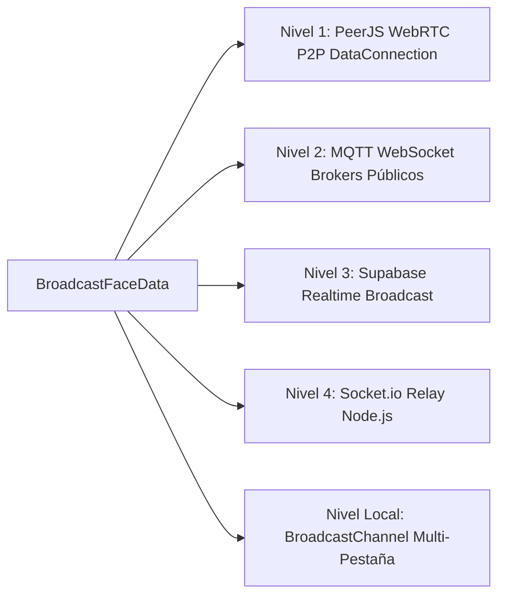
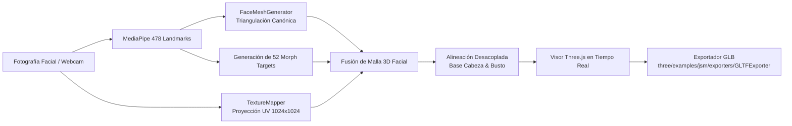

# Tech Reference: Arquitectura y Componentes de XStreamX

> **Documento:** Referencia Técnica y Arquitectura del Sistema (Tech Reference)  
> **Proyecto:** XStreamX (3D Avatar Telepresence & Collaborative Space)  
> **Licencia:** Apache License, Version 2.0  
> **Origen del Proyecto:** XStreamX ([Repositorio Privado](https://github.com/qwertyui1980/presidents.git))  
> **Fecha de Emisión:** Octubre 2026  

---

## 1. Resumen Ejecutivo y Filosofía de Diseño

**XStreamX** es una plataforma de telepresencia, videollamadas privadas y espacios colaborativos virtuales basada en **avatares 3D biomiméticos en tiempo real**. A diferencia de los sistemas tradicionales de videoconferencia (Zoom, Google Meet, Microsoft Teams) que capturan, comprimen y transmiten flujos continuos de video de alto ancho de banda hacia servidores centrales, XStreamX implementa una **Arquitectura de Privacidad por Diseño (Privacy-by-Design) y Cero-Transmisión de Video**.

### Principios Fundamentales

1. **Edge AI & Ejecución 100% Lado Cliente:** La captura de cámara, la inferencia de visión por computadora (MediaPipe Face Landmarker con 478 puntos tridimensionales) y el cálculo de expresiones faciales se ejecutan íntegramente en el hardware local del usuario (navegador web vía WebAssembly y WebGL).
2. **Cero Fuga Biométrica:** La cámara real jamás transmite video ni fotogramas sin procesar hacia servidores o participantes remotos. Ningún buffer de píxeles sale del dispositivo para la animación del avatar.
3. **Flujo Ultraligero de Blendshapes (Micro-Stream):** En lugar de transmitir megabytes de video continuo, el cliente transmite únicamente una estructura compacta de coeficientes numéricos normalizados de blendshapes (ARKit 52) y vectores de orientación espacial (yaw, pitch, roll), consumiendo apenas **pocos cientos de bytes por fotograma** a ~35–60 FPS.
4. **Renderizado 3D Descentralizado:** Cada cliente receptor reconstruye y renderiza localmente los avatares 3D de los demás participantes usando Three.js y aceleración por GPU. Esto reduce drásticamente el consumo de ancho de banda, elimina los costos de transcodificación de video en el servidor y escala de manera horizontal.

```mermaid
flowchart TD
    subgraph Cliente Local (Emisor)
        Cam[Cámara Web Local] -->|Captura de Frames| MP[MediaPipe Face Landmarker\n478 Puntos 3D]
        Mic[Micrófono Local] -->|Análisis Web Audio API| WA[Volumen & Frecuencia]
        MP -->|Coordenadas Faciales| Mapper[ARKit Blendshape Mapper\n52 Coeficientes]
        Mapper --> Payload[Payload Ultraligero\n~300 bytes/frame]
        WA -.->|Lip-sync fallback| Payload
    end

    subgraph Red de Transporte Híbrida
        Payload --> P2P[PeerJS WebRTC Mesh\nCanal de Datos Directo]
        Payload --> MQTT[Broker MQTT WebSockets\nMesh Global de Respaldo]
        Payload --> Supa[Supabase Realtime\nCanal Broadcast]
        Payload --> Sock[Socket.io / Servidor Node.js\nSeñalización & Respaldo]
    end

    subgraph Clientes Remotos (Receptores)
        P2P & MQTT & Supa & Sock --> Sync[Recepción de Micro-Stream]
        Sync --> Interp[Interpolación & Damping]
        Interp --> Three[Motor Three.js WebGL]
        Three --> Screen[Renderizado 3D Local del Avatar]
    end
```

---

## 2. Pila Tecnológica (Tech Stack)

| Capa | Tecnología | Versión | Rol en el Sistema |
| :--- | :--- | :--- | :--- |
| **Runtime & Servidor** | Node.js + Express + `tsx` | 22.x / 4.21 | Servidor HTTP, middleware de señalización Socket.io y servidor de estáticos |
| **Frontend Framework** | React + TypeScript | React 19 / TS 7.0 | UI reactiva, estado de sala, gestión de hardware y modales |
| **Bundler & Build Tool**| Vite | 8.3 | Servidor de desarrollo HMR ultrarrápido y empaquetado de producción |
| **Motor Gráfico 3D** | Three.js | 0.186 | Escenas 3D, OrbitControls, morph targets, shaders, carga GLTF/OBJ/STL |
| **Visión Artificial** | `@mediapipe/tasks-vision` | 1.0.1 | Detección facial, 478 landmarks 3D y blendshapes en tiempo real en browser |
| **Audio Processing** | Web Audio API nativo | W3C Standard | Detección de volumen, audio reactivo y streaming WebRTC de voz |
| **Red P2P & Señalización**| PeerJS + Socket.io Client + MQTT | 1.5.5 / 4.8.4 / 5.16 | Malla de canales de datos de baja latencia y conmutación por error cuádruple |
| **Persistencia & Tiempo Real**| Supabase JS SDK + LocalStorage | 2.117 | Canales en tiempo real, registro de usuarios y fallback local |
| **Estilos & Animación** | Tailwind CSS v4 + Lucide React | 4.3.3 / 0.546 | Sistema de diseño oscuro premium, glassmorphism e iconografía |

---

## 3. Arquitectura de Red Híbrida Cuádruple (Quad-Mesh Network)

Para garantizar conexión ininterrumpida y resiliencia total contra fallas de cortafuegos o caídas de servidores, [`src/services/networkService.ts`](file:///d:/Apps/xstreamx/src/services/networkService.ts) implementa una **estrategia de transporte en 4 niveles concurrentes**:



1. **Nivel 1: PeerJS WebRTC Direct Mesh (P2P de latencia cero):**
   * Establece conexiones directas `DataConnection` (SCTP sobre DTLS) entre pares.
   * La voz se transmite mediante `MediaConnection` WebRTC directa cifrada punto a punto.
   * Proporciona la latencia más baja posible (~10–30 ms) sin costo de servidor.
2. **Nivel 2: Public MQTT WebSocket Mesh (Respaldo global de alta concurrencia):**
   * Conexión por WebSockets seguros (`wss://broker.emqx.io:8084/mqtt`, `wss://broker.hivemq.com:8884/mqtt`).
   * Patrón publicación/suscripción mediante temas de sala dinámicos (`xstreamx/rooms/{roomId}/features`).
   * Salta firewalls estrictos (NAT simétrico) sin requerir servidores TURN dedicados.
3. **Nivel 3: Supabase Realtime Channels:**
   * Utiliza WebSockets multiplexados de Supabase para eventos de presencia, sincronización de estado y difusión de eventos de administración.
4. **Nivel 4: Socket.io Central Server Relay:**
   * Fallback sobre el servidor Node.js/Express local (`server.ts`).
   * Se encarga de la negociación de salas, control de presencia, sincronización de video y expulsión de usuarios.
5. **Nivel Multi-Pestaña Local (`BroadcastChannel`):**
   * Canal nativo `xstreamx_mesh_channel` que permite sincronizar múltiples ventanas o pestañas en la misma máquina sin consumir ancho de banda de red.

---

## 4. Pipeline de Visión por Computadora y Animación Facial

El núcleo de animación biomimética reside en [`src/services/mediapipeService.ts`](file:///d:/Apps/xstreamx/src/services/mediapipeService.ts) y [`src/services/face3d/arkitMapper.ts`](file:///d:/Apps/xstreamx/src/services/face3d/arkitMapper.ts):

### 4.1. Detección y Extracción de Características
* MediaPipe procesa el feed de la cámara web a 60 FPS generando 478 puntos tridimensionales normalizados ($x, y, z$).
* Se calculan automáticamente:
  * **Apertura Ocular Izquierda/Derecha:** Distancia euclidiana entre párpados superiores e inferiores normalizada frente a la escala de la órbita ocular.
  * **Orientación Cefálica (Head Pose):** Ángulos de inclinación (*Pitch*), giro (*Yaw*) y ladeo (*Roll*) deducidos del vector normal del triángulo nariz-ojos.
  * **Apertura de Mandíbula y Boca:** Coordenadas de los labios interiores y comisuras para detectar sonrisas, muecas y silbidos.

### 4.2. Mapeador de 52 Blendshapes ARKit Estándar
[`ARKitBlendshapeMapper`](file:///d:/Apps/xstreamx/src/services/face3d/arkitMapper.ts) traduce la salida de MediaPipe al estándar universal de Apple ARKit:
* **Ojos (14):** `eyeBlinkLeft`, `eyeBlinkRight`, `eyeLookDownLeft`, `eyeLookDownRight`, `eyeLookInLeft`, `eyeLookInRight`, `eyeLookOutLeft`, `eyeLookOutRight`, `eyeLookUpLeft`, `eyeLookUpRight`, `eyeSquintLeft`, `eyeSquintRight`, `eyeWideLeft`, `eyeWideRight`.
* **Cejas (5):** `browDownLeft`, `browDownRight`, `browInnerUp`, `browOuterUpLeft`, `browOuterUpRight`.
* **Mandíbula (4):** `jawForward`, `jawLeft`, `jawRight`, `jawOpen`.
* **Boca (23):** `mouthClose`, `mouthFunnel`, `mouthPucker`, `mouthLeft`, `mouthRight`, `mouthSmileLeft`, `mouthSmileRight`, `mouthFrownLeft`, `mouthFrownRight`, `mouthDimpleLeft`, `mouthDimpleRight`, `mouthStretchLeft`, `mouthStretchRight`, `mouthRollLower`, `mouthRollUpper`, `mouthShrugLower`, `mouthShrugUpper`, `mouthPressLeft`, `mouthPressRight`, `mouthLowerDownLeft`, `mouthLowerDownRight`, `mouthUpperUpLeft`, `mouthUpperUpRight`.
* **Mejillas (3):** `cheekPuff`, `cheekSquintLeft`, `cheekSquintRight`.
* **Nariz (2):** `noseSneerLeft`, `noseSneerRight`.
* **Lengua (1):** `tongueOut`.

---

## 5. Motor Gráfico 3D y Generador de Personajes

Implementado en [`ThreeAvatarCanvas.tsx`](file:///d:/Apps/xstreamx/src/components/avatars/ThreeAvatarCanvas.tsx) y [`threeCharacterBuilder.ts`](file:///d:/Apps/xstreamx/src/components/avatars/threeCharacterBuilder.ts):

### 5.1. Tipos de Avatares Soportados
1. **Avatares Procedurales:**
   * `three_robot`: Humanoide mecatrónico procedural con visor LED, antenas dinámicas y emisivos reactivos a la voz.
   * `cat_3d`: Avatar estilizado de felino con orejas articuladas, bigotes y cinemática en párpados.
   * `lowpoly_human` / `anime_girl`: Mallas humanoides ligeras optimizadas para rendimiento móvil.
2. **Modelos 3D de Busto y Esculturas (OBJ, STL, GLB):**
   * Soporta carga de modelos históricos y escultóricos (`Bush_standard.stl`, `Jinping.obj`, `Ptin2.obj`, `Thatcher_bust.obj`) con normalización geométrica automática, corrección de normales y re-centrado respecto al origen.
3. **Avatares Personalizados Face-to-Blendshape:**
   * Mallas faciales generadas por el Administrador con mapeo de textura fotográfica y 52 morph targets.

### 5.2. Cinemática Orgánica del Torso y Busto
* A diferencia de cabezas flotantes estáticas, el sistema integra **cinemática bi-articular de torso**:
  * **Flexión de Cuello:** Distribución gradual de la rotación cefálica (70% en cráneo, 30% en vértebras cervicales).
  * **Balanceo de Hombros:** Reacción con retraso elástico (*spring physics*) al cabeceo lateral (*Roll*).
### 5.3. Sincronización Universal de Boca y Mandíbula para Modelos 3D y Personalizados
* **Resolución Inteligente de Nombres de Morph Targets:**
  * Remueve prefijos de malla (e.g. `Wolf3D_Avatar.jawOpen`, `CC_Base_Body:mouthOpen`, `Head.jaw`) y normaliza alias universales (`jawOpen`, `mouthOpen`, `mouth_open`, `jaw_open`, `jaw`, `open`, `viseme_aa`, `v_aa`, `aa`, `fcl_mth_o`).
* **Supresión Activa de Conflictos (`mouthClose`):**
  * Atenúa dinámicamente el blendshape `mouthClose` cuando `finalJaw > 0`, erradicando el conflicto biomecánico donde MediaPipe cerraba los labios mientras la mandíbula intentaba abrirse.
* **Cinemática Dental y Mandibular Esquelética:**
  * Desplaza automáticamente la arcada dental inferior (`lowerTeeth`) en la cavidad oral anatómica de modelos Face-to-3D.
  * Detecta y rota huesos esqueléticos de mandíbula (`customJawBone`) en modelos con rig/esqueleto.
* **Apertura Articulada y Respuesta sin Lag:**
  * Factor de apertura calibrado (1.25x) con ataque rápido (interpolación a 0.65) para sincronización labial nítida en tiempo real tanto por webcam como por audio lip-sync.

---

## 6. Módulo de Administración: Estudio 3D Face-to-Blendshape

Ubicado en [`src/components/admin/FaceBlendshapeStudioModal.tsx`](file:///d:/Apps/xstreamx/src/components/admin/FaceBlendshapeStudioModal.tsx) y [`src/services/face3d/faceToBlendshapeService.ts`](file:///d:/Apps/xstreamx/src/services/face3d/faceToBlendshapeService.ts):



### Características Técnicas del Estudio:
* **Generación a partir de Foto Única:** Genera una malla de 478 vértices y ~900 triángulos texturizada por coordenadas UV calculadas sobre el rostro con normalización ortonormal frontal canónica.
* **Sistema de Ojos 3D Biomiméticos con Seguimiento por Webcam (`EyeGenerator`):**
  * Genera esferas oculares tridimensionales con esclera PBR cálida, estroma de iris procedural multiradial de 512x512 (anillo limbal, fibras estromales, collarette y pupila) y córnea con refracción física vítrea (IOR 1.376 y clearcoat).
  * **Seguimiento Ocular en Tiempo Real:** Las esferas rotan dinámicamente en Yaw (±26°) y Pitch (±20°) acopladas a la mirada del usuario capturada por la webcam mediante los puntos de iris MediaPipe (468 y 473) y blendshapes ARKit (`eyeLook*`), tanto en el visor de administración como en todas las salas de videoconferencia a través de [`threeCharacterBuilder.ts`](file:///d:/Apps/xstreamx/src/components/avatars/threeCharacterBuilder.ts).
  * Paleta de 8 presets de iris (Cyber Cyan, Azul Océano, Verde Esmeralda, Miel/Avellana, Marrón Café, Gris Platino, Violeta Neón, Rojo Carmesí) y selector RGB hex libre.
* **Calibración Anatómica de Boca y Cavidad Oral (`FaceMeshGenerator`):**
  * Elimina el estiramiento plano de texturas al hablar mediante curvatura tridimensional en Z y recesión anatómica sobre dientes.
  * **Parámetros Paramétricos de Boca:** Hundimiento oral hacia el interior (`mouthDepthPush`), volumen y grosor de labios (`lipThickness`), alineación vertical de altura (`mouthOffsetY`), elevación de comisuras para evitar gesto caído (`smileOffset`) y amplitud máxima de mandíbula (`jawOpenScale`).
  * **Cavidad Oral Interna y Dientes 3D (`generateOralCavityMesh`):** Cámara oscura anatómica con arcadas dentales superior e inferior acopladas detrás de los labios; la arcada dental inferior (`lowerTeeth`) desciende dinámicamente con `jawOpen` al hablar o cantar.
* **Alineación 100% Desacoplada en 4 Vías:** Panel de calibración con selectores dedicados para *Malla Facial*, *Boca y Labios*, *Ojos 3D* y *Base de Cabeza*.
* **Generador de Busto Procedural:** Permite equipar hombros ejecutivos con traje formal, corbata personalizable en color, camisa de vestir o cuello redondo con cinemática reactiva a 60 FPS.
* **Espejo Webcam en Vivo (Live Mirror):** Prueba interactiva en tiempo real donde la cara, ojos y cuello del usuario animan el avatar antes de guardarlo.
* **Exportación Estándar GLB:** Genera archivos `.glb` con texturas empaquetadas, materiales físicos PBR, ojos 3D, cavidad oral y los 52 morph targets listos para su uso en Unity, Unreal Engine, Blender o la propia plataforma.

### 6.1. Control de Acceso y Permisos en el Lobby (`Lobby.tsx`):
* **Exclusividad para Administrador (`role: 'admin'`):**
  * La creación de avatares fotogramétricos biomiméticos mediante foto (`+ Foto 3D` / `Face to 3D`) y la importación de nuevos modelos 3D (`Subir 3D` / `Gestionar Modelos`) están restringidas estrictamente a administradores autenticados.
  * Para los participantes estándar, el Lobby presenta una cuadrícula limpia de avatares sin botones de creación o subida ni accesos directos de eliminación con "X", garantizando una experiencia de usuario despejada y segura contra borrados accidentales.
  * La gestión y eliminación autorizada de modelos permanece centralizada para el administrador dentro del panel `AdminControlPanel`.

---

## 7. Módulos Interactivos de Sala

### 7.1. Home Theater y Reproductor Sincronizado de YouTube
* [`YouTubeSyncPlayer.tsx`](file:///d:/Apps/xstreamx/src/components/theater/YouTubeSyncPlayer.tsx) y [`HomeTheaterWindow.tsx`](file:///d:/Apps/xstreamx/src/components/theater/HomeTheaterWindow.tsx):
  * Utiliza la API IFrame de YouTube con control estricto de tiempo de reproducción.
  * Algoritmo de sincronización con tolerancia de desviación (*drift threshold*) de 1.5 segundos: solo aplica `seekTo` si el desfasaje supera el umbral, previniendo stuttering.
  * Cola colaborativa de videos con soporte para saltar, pausar y reproducción sincronizada multi-usuario gobernada por el administrador.

### 7.2. Pizarra Colaborativa (Whiteboard)
* [`WhiteboardPanel.tsx`](file:///d:/Apps/xstreamx/src/components/whiteboard/WhiteboardPanel.tsx):
  * Lienzo interactivo basado en HTML5 Canvas con soporte para trazos vectoriales, formas geométricas, texto y colores.
  * Transmisión de trazos en tiempo real vía `WhiteboardStroke` distribuidos a través del canal de red híbrido.

---

## 8. Servidor de Señalización y Ciclo de Vida de Sala (`server.ts`)

* **Control de Presencia Unificada:** Implementa `rooms = new Map<string, Room>()` con persistencia en memoria y reconexión rápida.
* **Cierre Autoritativo de Sala por Salida del Administrador:**
  * Si el usuario con rol `admin` abandona la sala o desconecta su socket, el servidor emite inmediatamente el evento `room_closed` a todos los clientes.
  * Todos los participantes son devueltos de forma limpia al lobby y se cierran todos los streams de hardware (cámara y micrófono).

---

## 9. Seguridad, Cumplimiento y Marco Legal

| Aspecto | Implementación Técnica | Documento de Respaldo |
| :--- | :--- | :--- |
| **Licencia de Código Abierto** | Licencia **Apache 2.0** con apéndice de privacidad y cláusula de atribución obligatoria | [`LICENSE`](file:///d:/Apps/xstreamx/LICENSE) |
| **Privacidad Biométrica** | Procesamiento en el borde (*Edge Computing*); cero almacenamiento o transmisión de imágenes de cámara | [`Login.tsx`](file:///d:/Apps/xstreamx/src/components/auth/Login.tsx) |
| **Atribución de Origen** | Requisito expreso de conservar *"Origin: Originally created and developed by XStreamX"* | [`LegalDisclaimerModal.tsx`](file:///d:/Apps/xstreamx/src/components/common/LegalDisclaimerModal.tsx) |
| **Gestión de Hardware** | Liberación proactiva y segura de pistas `MediaStreamTrack.stop()` al abandonar llamadas | [`src/App.tsx`](file:///d:/Apps/xstreamx/src/App.tsx) |
| **Repositorio Fuente** | Desarrollo privado centralizado en `https://github.com/qwertyui1980/presidents.git` | [`package.json`](file:///d:/Apps/xstreamx/package.json) |

---

## 10. Estructura de Directorios del Código Fuente

```text
xstreamx/
├── public/                       # Activos estáticos públicos
│   ├── models/                   # Modelos 3D (OBJ, STL, GLTF, GLB)
│   ├── favicon.svg               # Identidad gráfica
│   └── 404.html                  # Soporte SPA para GitHub Pages / subrutas
├── src/                          # Código fuente principal de la aplicación
│   ├── App.tsx                   # Controlador maestro de estado, sala y hardware
│   ├── main.tsx                  # Punto de entrada de renderizado React
│   ├── index.css                 # Estilos globales y utilidades Tailwind
│   ├── types/                    # Definiciones de tipos TypeScript globales
│   ├── components/
│   │   ├── admin/                # FaceBlendshapeStudioModal (Estudio 3D de avatares)
│   │   ├── auth/                 # Login (Controlador de acceso, modal de credenciales y privacidad)
│   │   ├── home/                 # PresidentesNeonHome (Landing con figuras neón y glitch aleatorio)
│   │   ├── avatars/              # ThreeAvatarCanvas, threeCharacterBuilder, configs
│   │   ├── common/               # Header, LegalDisclaimerModal, StarfieldBackground
│   │   ├── lobby/                # Lobby interactivo de entrada y selección de avatar
│   │   ├── room/                 # RoomView, CallControls, VideoGrid, ChatSidebar
│   │   ├── theater/              # YouTubeSyncPlayer, HomeTheaterWindow, QueueModal
│   │   ├── tracking/             # FaceTrackingVisionModule
│   │   └── whiteboard/           # WhiteboardPanel (Pizarra interactiva sincronizada)
│   ├── services/
│   │   ├── audioService.ts       # Web Audio API, análisis de volumen y muting
│   │   ├── mediapipeService.ts   # MediaPipe Face Landmarker y tracking 60 FPS
│   │   ├── networkService.ts     # Quad-Mesh networking (PeerJS, MQTT, Supabase, Socket)
│   │   ├── dbService.ts          # Gestión de usuarios, salas y persistencia
│   │   ├── supabaseClient.ts     # Cliente y canales broadcast de Supabase
│   │   └── face3d/               # Pipeline de reconstrucción 3D (ARKit, mesh, UV, bust)
│   └── utils/
│       ├── assetUrl.ts           # Resuelve rutas absolutas/relativas en subcarpetas
│       └── youtube.ts            # Utilidades de parsing y validación de IDs de YouTube
├── LICENSE                       # Licencia Apache 2.0 con apéndice de privacidad
├── README.md                     # Resumen de proyecto y arranque rápido
├── package.json                  # Dependencias, scripts y metadatos
├── server.ts                     # Servidor Node.js Express + Socket.io en tiempo real
├── supabase_schema.sql           # Esquema de base de datos PostgreSQL / Supabase
└── vite.config.ts                # Configuración de compilación Vite
```
